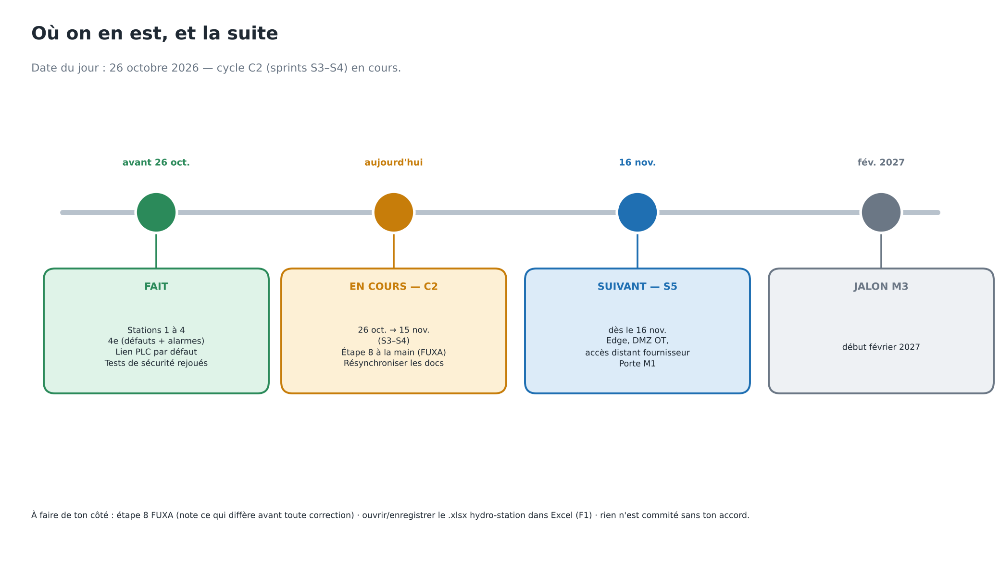
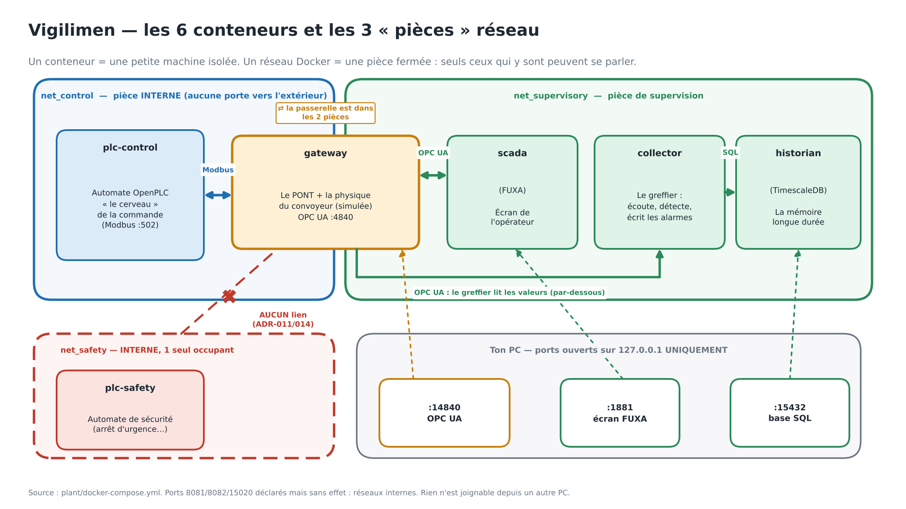
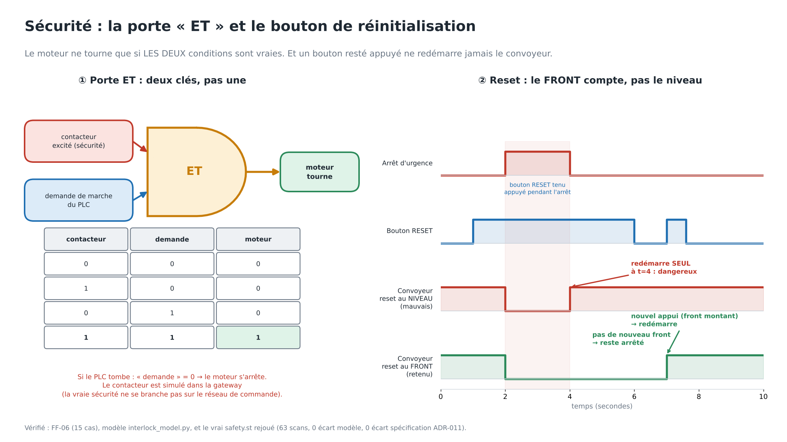
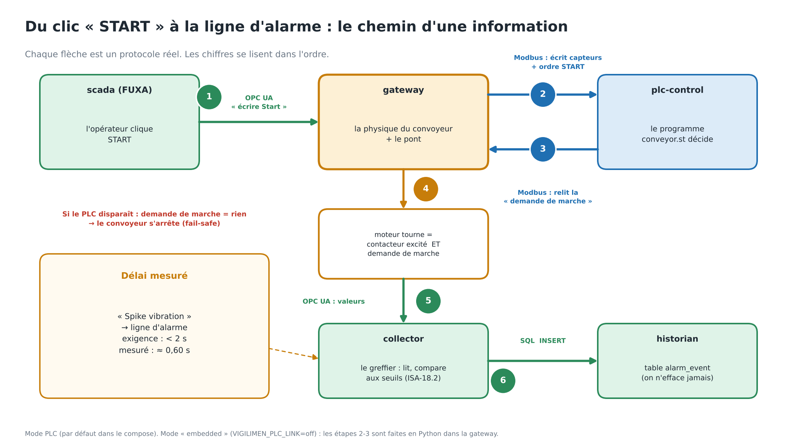
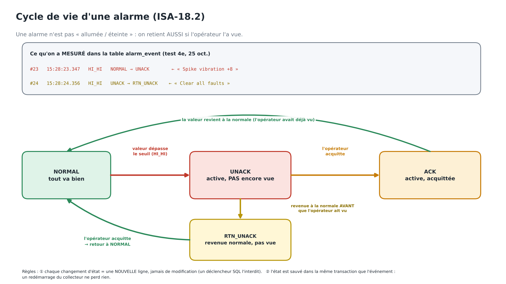
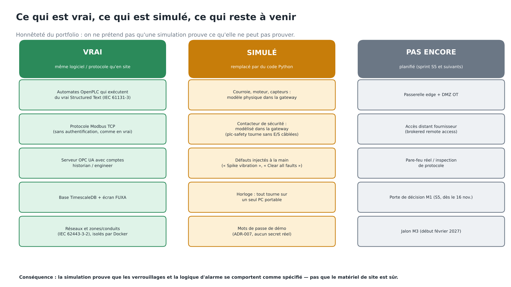

# Vigilimen — état des lieux complet (Stations 1 à 4, liaison PLC validée dans Docker)

Dernière mise à jour : 26 octobre 2026, 14 h. Même contenu que le doc du projet « MINE 360 » (`claude/VIGILIMEN-etat-des-lieux.md`). Schémas : `docs/img/01…06-*.png` (intégrés ci-dessous). Les anciens `architecture`, `chemin-valeur`, `etats-alarme` (état d'avant la liaison PLC) sont remplacés par les schémas 01, 02 et 04 et retirés du dépôt.

## En bref




La station CONV-001 (un convoyeur de mine simulé) tourne en local dans six conteneurs Docker : deux automates OpenPLC, un gateway OPC UA, un historien TimescaleDB, un collecteur et un SCADA FUXA. Les stations 1 à 4 sont faites. **Le 25 et le 26/10, 4e, la liaison PLC, la persistance des alarmes, l'isolation, les déclenchements de `conveyor.st` et le rejeu de `safety.st` ont été validés dans Docker.**

**Vérifié sur la machine d'Epiphane (avant le 25/10)**

- Six conteneurs sains ; `conveyor.st` et `safety.st` compilent et tournent dans OpenPLC (version d'avant les variables `AT`).
- Le PLC de commande ne peut pas atteindre le PLC de sécurité (preuve réseau capturée, mais voir le constat sur le `ping`).
- Le gateway refuse les sessions anonymes ; le collecteur écrit 7 tags par seconde ; FUXA affiche les valeurs et START fait démarrer le convoyeur.

**Validé dans Docker (logs dans `docs\runs\`)**

| Élément | Résultat |
|---|---|
| 4e sur le modèle embedded (`validate-4e.ps1`, FF-26) | 7/7. Alarme Vibration HI_HI puis RTN_UNACK dans `alarm_event`. FUXA (import, START, Spike, Clear) confirmé à la main |
| Liaison gateway ↔ PLC-CONV-001 en Modbus (ADR-013, **Accepted**) | `linked to plc-control:502, read-back clean`. START attend **10,4 s** (l'avertisseur de `conveyor.st`). Spike → ligne `alarm_event` en **0,60 s** |
| Compilation de `conveyor.st` avec les variables `AT` | OK **après correction** : MatIEC refuse un bloc `VAR` qui mélange variables localisées et ordinaires. `%QW112` = registre 112 (signature lue = 1) |
| Persistance des alarmes (ADR-019, **Accepted**) | Redémarrage du collecteur en pleine alarme : un seul `NORMAL→UNACK`, `alarm_state` conservé. Le déclencheur refuse un UPDATE sur `alarm_event` |
| Durabilité de l'historique (FF-28, `validate-durability.ps1`) | 21 contrôles verts le 26/10 (embedded, persistance ON). DELETE (une ligne, toutes), TRUNCATE (simple et CASCADE) et UPDATE refusés par le déclencheur, 31 lignes avant et après. Auto-test du banc : sans les déclencheurs, DELETE et TRUNCATE réussissent (le test peut échouer). Redémarrage du collecteur PENDANT SHELVED : même échéance, aucun second `NORMAL→UNACK`. Expiration après le redémarrage : un seul `SHELVED→UNACK`. Limites : le shelve est fait par un script (pas d'écran opérateur), l'attendu vient de l'ADR-019 et d'ISA-18.2 |
| Isolation du SIS en direct (`prove-isolation.ps1`) | 7/7 : un seul membre, DNS non résolu, `Network is unreachable` par IP vers 8080 et 502, témoin positif CONNECTED |
| CI GitHub | Verte (run n°14, commit `4547f93`, 26/10) : FF-01, 02, 03, 05, 06, 07, 13, 14, 21 à 25. Runners épinglés `ubuntu-24.04`, `checkout@v5`, `setup-terraform@v4` ; plus aucune annotation (constat sur la page Summary). FF-26, 27 et 28 ne tournent pas en CI (Docker). Le run n°9 (`e9d796c`) était déjà vert après le retrait du fichier plcio |
| `safety.st` exécuté pour de bon (`replay-safety.ps1`) | 63 scans, 12 scénarios. **Avant la correction du modèle : 2 écarts avec le modèle (`reset_held_across_trip`), 0 avec l'exigence ADR-011**, donc le défaut était dans le modèle. **Après (26/10, 0 h 57) : 0 écart avec le modèle, 0 avec l'exigence.** Le programme respecte l'ADR-011 sur les 63 scans |
| Déclenchements de `conveyor.st` dans OpenPLC (`validate-trips.ps1`, FF-27) | 13/13, et de nouveau 13/13 le 26/10 après la reconstruction du gateway (reset en impulsion). Surcharge 42 A : FAULT en 1,6 s. Un second START n'efface pas le défaut, STOP oui. Une trame Modbus forgée (palier à 96 °C, sans identifiant) déclenche le PLC en 0,21 s |

**Pas encore prouvé**
- Prouvé le 26/10 (14 h 35, embedded + persistance ON, `validate-durability.ps1 -Extended`, log `durability-20261026-143527.log`, 0 échec) : refus de DELETE et TRUNCATE (auto-test du banc inclus), redémarrage PENDANT SHELVED, expiration ensuite, scénario A (redémarrage APRÈS l'échéance : un seul `SHELVED>UNACK`), B (condition revenue pendant l'étagère : `SHELVED>NORMAL`, jamais UNACK), C (ACKED puis shelve : revient UNACK, l'acquittement n'est pas conservé).
- **Constat B, décision ouverte (pas un échec)** : quand la condition se termine pendant SHELVED, aucun événement n'est écrit ; l'historique montre `UNACK>SHELVED` puis `SHELVED>NORMAL`. Exigence ISA-18.2 sur ce point non vérifiée.

**Reste ouvert**
- Tout est commité et poussé (arbre propre au 26/10, 13 h 57). La pile locale peut être restée en embedded après `validate-durability.ps1` ou `validate-4e.ps1` : `docker compose up -d --build` pour revenir au mode PLC.
- Station 5 (analyse hydro-station) : sept constats (F1 à F7) dans `docs/assessments/hydro-station/EVALUATION-station5.md`. F1 (classeur sans valeurs en cache) traité le 26/10 : recalculé avec LibreOffice, 283 formules identiques, résultats égaux au script `s5_recompute_register.py` ; l'aspect visuel dans Excel n'est pas vérifié.
- Sprint S5 (edge, DMZ OT, accès distant courtié, porte M1) dès le 16/11 : cadrage dans `docs/sprints/S5-cadrage.md`. Numérotation : les fichiers du dépôt font foi (`docs/adr/NUMBERING.md`), prochain ADR libre ADR-020, résilience WAN = FF-29.
- Anciens schémas `architecture`, `chemin-valeur`, `etats-alarme` : retirés du dépôt (commit `5dd64d4`).

## Les conteneurs : à quoi sert chacun, et comment ils s'emboîtent




**L'idée en une phrase.** On a un convoyeur de mine qui n'existe pas. Pour étudier sa sécurité comme sur un vrai site, on a besoin des mêmes « pièces » qu'un vrai site, chacune dans sa propre boîte (un conteneur), reliées par des tuyaux précis (les réseaux). C'est cette séparation en boîtes qui rend la sécurité **mesurable** : on peut montrer qu'une boîte ne peut pas parler à une autre.

**Les six boîtes, avec une image simple**

| Conteneur | Image simple | Ce qu'il fait | Pourquoi il existe | Si on l'enlève |
|---|---|---|---|---|
| **`plc-control`** (OpenPLC) | Le **cerveau de la machine** | Exécute `conveyor.st` : séquence de démarrage (avertisseur 10 s), arrêt sur 95 °C ou 42 A, remise à zéro des défauts | Sur un vrai site c'est lui qui pilote le moteur. C'est lui qu'on attaque en S8 | Plus de logique de commande : la bande ne démarre pas (mode PLC) |
| **`plc-safety`** (OpenPLC) | Le **cerveau d'urgence**, séparé et muet | Exécute `safety.st` : arrêt d'urgence, câble d'arrêt, garde, dérive de bande | L'ADR-011 : la sécurité des personnes ne doit dépendre de rien de ce qui est piloté ou attaquable. Il n'a **aucune liaison** avec les autres | Plus de fonction de sécurité (ici elle est de toute façon modélisée à part, voir ADR-014) |
| **`gateway`** | Le **traducteur** et le **faux convoyeur** | (1) simule la machine : vitesse, courant, vibration, température ; (2) parle Modbus au PLC et OPC UA aux écrans ; (3) tient le contacteur de sécurité modélisé | Rien de physique n'existe, donc quelqu'un doit *être* la machine. Et le PLC et les écrans ne parlent pas la même langue (voir plus bas) | Plus de machine, plus de traduction : tout s'arrête |
| **`scada`** (FUXA) | L'**écran de l'opérateur** | Affiche la bande, les boutons START, STOP, « Spike vibration », « Clear all faults » | Un opérateur doit voir et commander. Choix de licence (ADR-012) | Plus d'interface ; le reste tourne |
| **`historian`** (TimescaleDB) | La **mémoire à long terme** | Base de données qui garde chaque valeur et chaque alarme avec leur date | Pour répondre « pourquoi a-t-on arrêté le trimestre dernier ? ». Une alarme sans historique ne sert pas à l'enquête | Plus d'historique ; la bande tourne quand même |
| **`collector`** | Le **greffier** | Toutes les secondes : lit 7 valeurs au gateway, les écrit dans la mémoire, et décide s'il y a une alarme (ISA-18.2) | Une base de données **stocke** mais n'aime pas aller chercher : il faut quelqu'un pour copier | Les valeurs ne sont plus enregistrées et aucune alarme n'est levée |

**Pourquoi le gateway, en détail.** Il fait trois métiers à la fois, parce que sur ce banc d'essai rien de physique n'existe :
1. **Il EST le convoyeur.** Sans lui personne ne produit de vibration ni de température. La physique (`conveyor_physics.py`) est dedans, et c'est là qu'on injecte les défauts (les cinq tags `Fault*`).
2. **Il traduit.** Les PLC parlent **Modbus**, une langue sans mot de passe ni identité. Les écrans et la base parlent **OPC UA**, avec connexion par nom et mot de passe. Le gateway est la porte entre les deux : c'est la « rupture de protocole ».
3. **Il tient le contacteur de sécurité modélisé.** Le vrai `plc-safety` n'est relié à rien, donc le gateway joue sa partie : le moteur tourne seulement si *le contacteur est enclenché ET le PLC demande la marche*.

C'est une **simplification assumée**. Sur un vrai site ce seraient trois choses différentes : la machine, une passerelle OPC UA, et un contacteur câblé. Ici une seule boîte les réunit. Conséquence honnête : le gateway est la pièce la plus « de confiance » du banc, donc la cible naturelle de S8.

**Pourquoi le collecteur, en détail.** Trois raisons :
- **Une base ne va pas chercher.** TimescaleDB attend qu'on lui écrive. Le collecteur lit le gateway et écrit à la base.
- **Il décide des alarmes.** « Cette vibration est-elle une alarme ? » est une décision qu'on veut garder avec l'historique, et qui doit survivre à un redémarrage. Il écrit l'événement et l'état dans **la même transaction** (ADR-019), pour qu'une panne en plein milieu ne perde rien.
- **Il est dans le bon réseau.** Il n'a accès qu'au côté supervision, s'identifie avec le compte `historian` et ne fait que lire. Si la base ou le collecteur est compromis, ils n'ont aucune route vers le PLC. *Limite à connaître* : ce compte `historian` peut techniquement écrire `StartCommand` et les `Fault*` (ADR-017).

**Les trois réseaux : des pièces avec des portes**

| Réseau | Qui est dedans | Particularité |
|---|---|---|
| `net_control` | `plc-control`, `gateway` | **Interne** : aucune sortie vers l'extérieur. Le gateway est le seul à pouvoir entrer |
| `net_supervisory` | `gateway`, `scada`, `historian`, `collector` | Le seul réseau avec des ports ouverts vers ta machine, uniquement sur `127.0.0.1` |
| `net_safety` | `plc-safety` seul | **Interne** et un seul membre (FF-22, preuve en direct `prove-isolation.ps1`) |

Le `gateway` est le **seul conteneur dans deux pièces à la fois** : c'est la porte entre la commande et la supervision, et c'est voulu.

**Qui parle à qui, dans quelle langue**

| De | Vers | Langue | Ce qui passe | Qui initie |
|---|---|---|---|---|
| `scada` | `gateway` | OPC UA (compte `engineer`) | Il lit les valeurs, il écrit START, STOP et les défauts | `scada` |
| `collector` | `gateway` | OPC UA (compte `historian`) | Il lit 7 valeurs à 1 Hz | `collector` |
| `collector` | `historian` | SQL (PostgreSQL) | Il écrit valeurs, événements d'alarme, état des alarmes | `collector` |
| `gateway` | `plc-control` | Modbus TCP, **sans authentification** | Il écrit les entrées simulées (température, courant, boutons), il lit la décision (marche, avertisseur) toutes les 0,5 s | `gateway` |
| *(personne)* | `plc-safety` | — | Rien. C'est le but | — |
| Toi | `scada`, `historian`, `gateway` | navigateur, `psql`, client OPC UA | Sur `127.0.0.1` seulement (ports 1881, 15432, 14840) | Toi |

**Un exemple suivi de bout en bout : tu appuies sur START**
1. Dans FUXA, tu cliques START. FUXA écrit `StartCommand = vrai` dans le gateway (OPC UA).
2. Toutes les 0,5 s, le gateway recopie ce bouton dans le PLC de commande (Modbus), avec la température, le courant et la vitesse simulés.
3. Le PLC voit le front montant du bouton et lance son **avertisseur de 10 secondes** (mesuré : 10,4 s). La bande ne bouge pas encore.
4. À la fin, le PLC demande la marche. Le gateway vérifie que le contacteur modélisé est enclenché, **puis seulement** il fait tourner la machine simulée : la vitesse monte à 2,5 m/s.
5. Chaque seconde, le collecteur lit ces valeurs et les écrit dans la base.
6. Tu cliques « Spike vibration +8 ». Le gateway ajoute 8 mm/s à la vibration, le collecteur la voit, dépasse le seuil, et écrit `HI_HI NORMAL→UNACK` dans l'historique en **0,6 s** (mesuré).
7. « Clear all faults » : la vibration redescend et le collecteur écrit `UNACK → RTN_UNACK` : l'alarme est revenue à la normale **sans que personne l'ait vue**, et c'est exactement ce qu'un simple oui/non effacerait.

**Pourquoi autant de boîtes plutôt qu'un seul programme ?** Parce que l'évaluation de sécurité (IEC 62443) porte sur des **zones** et des **conduits** : une zone est un groupe de choses de même niveau de risque, un conduit est le tuyau autorisé entre deux zones. Une boîte par rôle rend ces zones **réelles et testables**. On a prouvé en direct que le PLC de commande ne peut pas atteindre celui de sécurité (réseau injoignable). Dans un seul programme, cette preuve serait impossible.

**Ce qui est réel et ce qui est simulé**

| Réel | Simulé |
|---|---|
| OpenPLC, qui exécute de vrais programmes IEC 61131-3 | Le convoyeur lui-même (la physique est une formule) |
| FUXA, PostgreSQL/TimescaleDB, le protocole OPC UA | Le câblage de terrain : le gateway invente les valeurs que les capteurs donneraient |
| Les réseaux Docker, leur isolation, Modbus sur le fil | Le contacteur de sécurité (un modèle Python dans le gateway) et les opérateurs |

## Deux modes de fonctionnement : pourquoi le mode PLC est devenu le défaut

**En une phrase.** Le convoyeur peut tourner de deux façons : soit un **programme Python** dans le gateway décide de tout (mode *embedded*), soit le **vrai programme du PLC** (`conveyor.st`, dans OpenPLC) décide, et le gateway ne fait que la physique et le pont (mode *PLC*). Depuis le 26/10, c'est le mode PLC qui démarre quand on tape `docker compose up -d`.

| | Mode embedded (opt-out) | Mode PLC (défaut) |
|---|---|---|
| Qui décide : séquence de démarrage, arrêt sur 95 °C et 42 A | `interlock_model.py`, du Python **dans le gateway** | `conveyor.st`, un vrai programme IEC 61131-3 qui tourne **dans OpenPLC** |
| Les deux conteneurs OpenPLC | Tournent à côté, **ne décident rien** | `plc-control` décide ; `plc-safety` reste isolé et muet dans les deux modes |
| START | Immédiat | Attend l'avertisseur de **10 s** (mesuré 10,4 s) |
| Si le PLC est absent ou ne porte pas le bon programme | Sans effet, il ne décide rien | La bande **ne démarre pas** (échec sûr : aucune demande de marche) |
| Programme à charger à la main dans OpenPLC | Non | Oui, une fois : `conveyor_upload.st` |
| Une trame Modbus forgée peut-elle déclencher le PLC ? | Sans objet | **Oui, en 0,21 s** : le point central de S8 n'existe que dans ce mode |
| Persistance des alarmes (`alarm_state`) | Réglable séparément | Activée par défaut |
| Comment l'obtenir | `$env:VIGILIMEN_PLC_LINK = 'off'` puis `docker compose up -d` | Rien à faire (`VIGILIMEN_PLC_LINK` vaut `modbus` par défaut) |

**Pourquoi le défaut a changé (décision du 26/10)**
1. **En embedded, ce qu'on testait n'était pas le vrai programme.** La logique de commande était une réécriture Python ; `conveyor.st` tournait à côté sans rien décider. Une évaluation de sécurité qui attaque la couche PLC (S8) n'a de sens que si le PLC décide vraiment.
2. **Le lien est validé.** La liaison Modbus gateway-PLC (ADR-013) et les déclenchements de `conveyor.st` (FF-27, 13/13, y compris avec ce défaut) ont été prouvés dans Docker. Laisser par défaut un mode qu'on sait être le moins fidèle n'avait plus de raison d'être.
3. **La persistance l'est aussi.** Un historique d'alarmes qui change quand un conteneur redémarre n'est pas un enregistrement (ADR-019, FF-25, FF-26, FF-28), donc elle est activée par défaut dans le compose.
4. **Un défaut est une décision.** FF-22 vérifie maintenant que le défaut est le lien PLC, et l'étape 7 du BREAK IT du walkthrough le casse exprès pour le montrer.

**Pourquoi on garde quand même le mode embedded**
- C'est la **référence** : FF-06 et FF-07 raisonnent sur ce Python, et on peut comparer le comportement du PLC à ce qu'il aurait dû être.
- C'est le seul mode qui marche **sans rien installer** : sans programme chargé dans OpenPLC, le mode PLC affiche `PlcLinkOK = False` et la bande ne démarre pas. Un clone neuf ou une démonstration ne montrerait rien bouger.
- Il aide à **séparer les pannes** : si ça marche en embedded et pas en mode PLC, le défaut est dans le PLC ou le lien, pas dans le gateway.
- Le coût est réel : deux modes à garder honnêtes, et le risque d'en lancer un sans s'en apercevoir.

**Comment savoir dans quel mode on est**
- Le journal du gateway, à son démarrage : `Control function: PLC-CONV-001 over Modbus (...)` en mode PLC (puis `plc-link: linked to plc-control:502, read-back clean`), ou `Control function: embedded Python model (no PLC link)` en embedded.
- Le tag `PlcLinkOK` : `False` en embedded.
- START : immédiat en embedded, environ 10 s en mode PLC.
- Le journal du collecteur : `alarm state persistence: on` ou `off`.

**Piège.** `validate-4e.ps1` et `validate-durability.ps1` passent en embedded **pour eux-mêmes** et laissent la pile dans ce mode à la fin. Pour revenir au défaut : `docker compose up -d --build` (les variables d'environnement qu'ils posent ne restent pas dans ta fenêtre PowerShell). Ensuite, regarde le journal du gateway : `program signature 0, expected 1` veut dire que le PLC ne tourne pas le programme (il faut le démarrer, voir la passe 2 du walkthrough).

## Les tests de sécurité : comment je sais quoi attendre, et comment j'interprète




**La question à se poser devant chaque test : d'où vient le résultat attendu ?** Un test qui compare deux choses écrites par la même main mesure la cohérence, pas la justesse.

**Trois sources d'attente, d'autorité décroissante**

| Source | Rôle | Limite |
|---|---|---|
| **L'exigence** (ADR-011 et les règles qu'il énonce) | Elle dit ce qui doit arriver : démarrage à froid déclenché, déclenchement verrouillé, pas de redémarrage automatique, reset sur front, discordance = défaut | Écrite par le même auteur que le modèle et le programme. Ce n'est pas une norme indépendante (IEC 61511, ISO 13849) ni le résultat d'une analyse de risques menée par d'autres |
| **Le modèle Python** (`interlock_model.py`) | Reformulation exécutable de l'exigence, qui produit les sorties attendues (`safety_vectors.py`) | Même auteur, mêmes hypothèses. S'il se trompe comme le programme, le banc conclut « d'accord » et ne prouve rien |
| **Ma lecture du code** | Me sert à prédire un résultat avant de lancer | La plus faible. Elle m'a trompé dans ma façon de la défendre (voir plus bas) |

C'est pour cela que le fichier de vecteurs porte **deux colonnes** : ce que fait le modèle, et ce que l'ADR-011 exige. Où les deux diffèrent, elles sont listées avec la raison. Un programme qui suit le modèle mais pas l'exigence est le **pire** cas, pas le meilleur.

**Les 12 scénarios : ce qu'on attend, et d'où ça vient**

| Scénario | Attendu | Règle | Résultat du 26/10 |
|---|---|---|---|
| `boot_tripped_no_reset` | Contacteur ouvert, déclenché | Un démarrage à froid n'est pas un démarrage sûr | Concorde |
| `boot_then_reset_pulse` | S'enclenche après une impulsion de reset | Reset possible quand tout est sain | Concorde |
| `estop_drops` | Le contacteur tombe | Arrêt d'urgence à deux canaux | Concorde |
| `demand_clears_no_restart` | Reste déclenché quand la demande disparaît | Le déclenchement est verrouillé | Concorde |
| `reset_after_clear` | Se réenclenche après une impulsion de reset | Un opérateur doit regarder, puis réarmer | Concorde |
| `reset_pulse_while_demanded` | Reset refusé tant que la demande dure | On ne réarme pas sur un danger actif | Concorde |
| `pullcord_one_channel_fault_short` | Déclenche | Un canal ouvert est une demande d'arrêt | Concorde |
| `pullcord_discrepancy_to_fault` | Déclenche et reste déclenché | Discordance ≥ 500 ms = défaut de dispositif | Concorde |
| `belt_drift_trips`, `guard_open_trips` | Déclenche | Ces entrées sont des demandes d'arrêt | Concorde |
| `reset_refused_while_guard_open` | Reset refusé | Pas de réarmement garde ouverte | Concorde |
| **`reset_held_across_trip`** | **Reste déclenché** (bouton tenu, arrêt d'urgence qui disparaît) | **ADR-011 : le reset est un front montant. Un bouton coincé ne doit pas relancer la bande** | **Avant correction : le programme respectait l'exigence, le modèle non (pas 3 et 4). Après : les deux** |

**Le cas qui compte.** Dans le dernier scénario, le modèle réinitialisait (avant le 26/10, 1 h) sur le **niveau** du bouton, donc il réenclenche. `safety.st` exige un nouveau front, donc il reste déclenché. Ici l'oracle (le modèle) contredit l'exigence. Se contenter de « le programme égale le modèle » aurait fait conclure que le programme est défectueux, alors que c'est le modèle qui l'est. Et ce modèle, par le gateway qui maintient le reset à 1, redémarrerait seul dans la simulation le jour où un arrêt d'urgence y serait simulé.

**Comment j'interprète une issue**

| Ce qu'on voit | Ce que ça veut dire | Ce que je fais |
|---|---|---|
| Programme = modèle = exigence | Cohérent sur ce cas | Rien. Ce n'est pas une preuve de justesse |
| Programme ≠ modèle, programme = exigence | Le modèle est défectueux | Je le dis, je propose de corriger le modèle |
| Programme ≠ modèle, programme ≠ exigence | **Défaut possible du programme** | Je te le présente avant de toucher à quoi que ce soit. Corriger le « mauvais » côté par réflexe est une décision de sécurité, qui t'appartient |
| Programme = modèle ≠ exigence | Le pire cas : deux erreurs identiques | Je t'alerte en premier |
| Résultat surprenant, dans un sens ou dans l'autre | **Je soupçonne d'abord l'instrument** | Je valide le banc (mutations, test témoin) avant de conclure |

**Ce que cette session m'a appris sur mes propres instruments.** Six erreurs de ma part ont été détectées par l'exécution, pas par la lecture : un faux PLC qui croyait qu'OpenPLC ignore les écritures non déclarées ; une preuve d'isolation (`ping`) qui ne pouvait pas échouer ; un script d'isolation qui échouait pour une raison de guillemets ; un compilateur qui refusait le mélange de variables localisées et ordinaires, invisible à FF-23 ; un banc dont l'instance vivait sur la pile, donc remplie de restes ; et un run dont la sortie ressemblait à l'ancien alors que le modèle avait changé (cause non établie, la plus probable étant une sortie périmée). Le banc local m'a fait annoncer « 0 divergence », puis « ma prédiction était fausse », deux fois à tort. **J'ai conclu sur un instrument que je n'avais pas validé.** Le script affiche désormais ce que le conteneur a reçu.

**L'ampleur : ce que ce banc n'établit pas**
- **Ce n'est pas une fonction de sécurité certifiée.** OpenPLC v3 n'est pas une plateforme de sécurité certifiée, aucun niveau SIL n'est revendiqué, et il n'y a eu ni analyse HAZOP, ni vérification fonctionnelle indépendante, ni test périodique du matériel.
- **Une seule main** a écrit l'exigence, le modèle, le programme et les scénarios. Les scénarios sont ceux auxquels j'ai pensé : les défauts simultanés, la perte d'alimentation, le rebond d'un contact, le contacteur soudé (le programme n'a pas d'entrée de retour d'état du contacteur) ne sont pas couverts.
- **Le temps** : le banc rejoue des pas de 100 ms avec une horloge simulée, pas le cycle réel du PLC, et la limite de 500 ms de la discordance n'est pas testée à sa frontière.
- **La valeur du dispositif est ailleurs** : montrer comment on établit et conteste une séparation (réseau, programme, essais), pas démontrer qu'un convoyeur est sûr.

**Ce que tu peux dire sans exagérer.** « `safety.st` compile, il est structurellement indépendant du contrôle (FF-21), isolé du réseau de commande (FF-22 et preuve en direct), et exécuté contre un modèle sur 63 scans. Une divergence réelle a été trouvée, attribuée au modèle et non au programme, puis corrigée. » **Ce que tu ne peux pas dire :** « vérifié », « SIL », « sûr ».

## Vue d'ensemble

```text
net_supervisory
  [SCADA FUXA :1881] <--OPC UA--> [Gateway OPC UA :4840] --OPC UA--> [Collecteur 1 Hz] --SQL--> [Historien :15432]
                                  (dans les deux réseaux)

net_control (internal)
  [Gateway] ==Modbus FC15/16/1/3, client== [PLC-CONV-001 :502]     (mode PLC, le défaut ; non câblé avec `VIGILIMEN_PLC_LINK=off`)

========= aucune route entre net_control et net_safety (FF-22 sur le papier, prove-isolation.ps1 en vrai) =========

net_safety (internal, un seul membre)
  [SIS-CONV-001, safety.st]   aucune liaison. Son contacteur est un modèle Python dans le gateway (ADR-014)
```

Ports sur 127.0.0.1 seulement (1881 FUXA, 14840 OPC UA, 15432 base). **8081 et 8082 ne fonctionnent pas** : Docker ignore `ports:` sur un réseau `internal`. Les interfaces OpenPLC s'ouvrent par `tools\plc-ui-relay.ps1`, un conteneur socat jetable.

## Le chemin d'une valeur




```text
FUXA boutons --OPC UA--> Gateway, boucle de 0,5 s (plant_cycle.py) :
  opt-out ("embedded", PLC_LINK=off) :        mode par défaut ("modbus") :
    interlock_model joue les deux contrôleurs   entrées simulées --Modbus--> PLC-CONV-001 (séquence, 95 °C, 42 A)
                                                run request <--Modbus-- PLC ; moteur = contacteur ET run request
  physique (courant, vibration, température) --> tags ns=2;i=6..12, status PLC i=20..22
       |-- OPC UA --> FUXA écran
       '-- OPC UA, 1 Hz --> Collecteur --> sample + AlarmFeed/engine --> alarm_event (+ alarm_state, persistance ON par défaut)
```

Avec le PLC dans la boucle, **START attend l'avertisseur de 10 s** de `conveyor.st` ; en mode embedded il est immédiat. Si le PLC ne répond pas ou que sa signature ne correspond pas, le gateway n'émet aucune demande de marche (échec sûr). Le reset du panneau est pressé **une seule fois** au premier scan après le démarrage du gateway.

## Comment chaque valeur est calculée

Calculées par le gateway toutes les 0,5 s (`plant/sim/conveyor_physics.py`), pas mesurées.

| Valeur | Formule (convoyeur en marche) |
| --- | --- |
| Load (t/h) | `0,78 × 850 + 0,10 × 850 × sin(t/220) + bruit` ; 0 à l'arrêt |
| Belt speed (m/s) | `2,5 × (1 − 0,18 × belt_slip)` |
| Motor current (A) | `8 + 30 × charge/850` + bruit, × défauts (glissement +22 %, galet +30 %, usure +5 %) |
| Vibration (mm/s) | `1,6 + 0,4 × charge/850` + bruit ; défauts : usure `5,5 × usure^1,5`, désalignement `+4,0`, galet `+2,0`, spike `+valeur`. **0 à l'arrêt** |
| Bearing temperature (°C) | tend vers `28 + 26 × charge/850` (+34 usure, +12 galet), constante 420 s ; retour vers 28 °C à l'arrêt, 900 s |

Mesuré le 25/10 : l'usure à 100 % seule plafonne vers **85 °C** ; atteindre 95 °C demande usure **et** galet grippé, environ **50 minutes**, et le déclenchement sur 42 A peut venir avant. FF-27 déclenche donc le 95 °C par une écriture Modbus directe.

## L'isolation de la sécurité

Le SIS est seul sur `net_safety` (`internal: true`). Ce qui le prouve maintenant :

- **FF-22** lit les fichiers compose fusionnés : un seul membre, ports en loopback, nom du PLC résolvable, six services attendus.
- **`tools\prove-isolation.ps1`** compte les membres du réseau, teste **par adresse IP**, traite un `REFUSED` comme un **échec** (un refus est un paquet venu de l'autre côté), et fait d'abord un test témoin positif.
- **FF-21** lit `safety.st` ; **FF-06** (15 cas) lit le modèle ; **`replay-safety.ps1`** l'exécute.

L'ancienne preuve `ping sis-conv-001` était vide : `sis-conv-001` est un `hostname:`, que le DNS de Docker ne résout jamais, donc elle échouait sur le nom, réseaux joints ou non.

## Les alarmes ISA-18.2




États : NORMAL, UNACK, ACKED, RTN_UNACK, SHELVED, SUPPRESSED, OOS. L'état qui compte est RTN_UNACK (revenue normale, jamais vue).

| Tag | Condition | Limite | Priorité | Délai |
| --- | --- | --- | --- | --- |
| BearingTemp_C | HI / HI_HI | 85 / 95 °C | HIGH / URGENT | 10 s / aucun |
| Vibration_mms | HI / HI_HI | 4,5 / 7,1 mm/s | LOW / HIGH | 30 s / aucun |
| Current_A | HI / HI_HI | 38 / 42 A | LOW / HIGH | 5 s / aucun |
| Speed_mps | LO / LO_LO | 2,0 / 0,1 m/s | LOW / HIGH | 15 s / aucun |

**Persistance (ADR-019, activée par défaut dans le compose).** Avant : un redémarrage du collecteur pendant une alarme acquittée la relevait en nouvel UNACK, perdait l'acquittement et écrivait deux fois l'incident. Maintenant l'état (`alarm_state`) est écrit dans **la même transaction** que les événements, chargé une fois au démarrage, et `alarm_event` est protégé par un déclencheur contre UPDATE/DELETE/TRUNCATE (pas un contrôle de sécurité : le propriétaire de la table peut le supprimer). Un volume existant demande `migrations/001_alarm_state.sql` une fois. Corrigé au passage : `pending()` avançait son repère avant l'insertion, donc un insert échoué perdait les événements.

## Inventaire

| Composant | Fichier | Rôle | Statut |
| --- | --- | --- | --- |
| Logique de commande | `plant/plc-control/conveyor.st` | Séquence, 95 °C, 42 A ; variables `AT` en bloc `VAR` séparé (ADR-013) | Compile et tourne dans OpenPLC ; déclenchements prouvés (FF-27) |
| Logique de sécurité | `plant/plc-safety/safety.st` | Fonction de sécurité | Compile ; rejouée : conforme à l'ADR-011 sur 63 scans |
| Modèle d'interlock | `plant/sim/interlock_model.py` | Modèle Python des deux contrôleurs ; reset sur front depuis `b55c150` | FF-06 (15 cas), banc |
| Contrat E/S | `plant/gateway/plc_io_map.py` | Table unique des adresses, `MAP_VERSION` | FF-23 |
| Liaison PLC | `plant/gateway/plc_link.py`, `plant_cycle.py` | Client Modbus, échec sûr, signature | Validée dans Docker ; FF-24 (faux PLC) |
| Gateway OPC UA | `plant/gateway/opcua_server.py` | ISA-95, comptes, défauts i=15..19, statut PLC i=20..22 | Mode PLC par défaut ; embedded = `VIGILIMEN_PLC_LINK=off` |
| Chargement OpenPLC | `plant/plc-upload/build.py` | Génère `*_upload.st` | À rejouer après chaque édition |
| Collecteur | `plant/historian/collector.py`, `alarms/store.py` | 7 tags à 1 Hz, alarmes, persistance | Persistance validée (FF-26, FF-28) ; activée par défaut dans le compose, `off` dans le code hors compose |
| Historien | `plant/historian/schema.sql`, `migrations/` | `sample`, `alarm_event`, `alarm_state` | Migration appliquée le 25/10 |
| SCADA | `plant/scada/project/` | Projet FUXA généré | Fichier d'import |
| Orchestration | `plant/docker-compose.yml` (seul fichier) | 6 services, 3 réseaux | mode PLC par défaut ; embedded = opt-out (`VIGILIMEN_PLC_LINK=off`) |
| Banc `safety.st` | `plant/tools/replay-safety.ps1`, `safety_replay.cpp`, `replay_stubs.cpp`, `replay.sh`, `scripts/safety_vectors.py` | Compile `safety_upload.st` en C (MatIEC) et rejoue 63 scans contre le modèle et contre l'exigence | Validé ; commité en local |
| Outils | `plant/tools/` | `validate-4e`, `validate-plcio`, `validate-trips`, `validate-durability` (FF-28), `prove-isolation`, `plc-ui-relay` | Lancés les 25 et 26/10 |

## Blocages rencontrés et corrections

**Avant le 25/10** (inchangés) : Docker/WSL arrêté ; image `openplc:v3` absente du registre ; build OpenPLC « vert » mais cassé (CRLF, MatIEC, `tee`) ; bail containerd expiré (veille) ; imports asyncua ; sonde de santé ; `.st` refusés (bits d'un WORD, CONFIGURATION) ; relais socat pour les UI ; page FUXA blanche ; boutons FUXA ; image gateway ancienne sans les nœuds `Fault*` (`build` puis `up -d`).

**Le 25/10, en local (détail dans `docs/runs/NOTES.md`) :**

| Symptôme | Cause | Correction |
| --- | --- | --- |
| FF-24 : « PLC perdu » ne coupait pas la marche | Double de test : `shutdown()` laisse les connexions établies | `stop()` ferme les sockets |
| FF-24 : un programme sans `Stop_PB` non détecté à l'arrêt | **Défaut de conception** : un coil non localisé lit FALSE, ce qu'on avait écrit | Signature `Plc_Map_Version` vérifiée à chaque cycle |
| `VIGILIMEN_MODBUS_HOST: plc-conv-001` | C'est un `hostname:`, non résolu par le DNS Docker | `plc-control` ; FF-22 le vérifie |
| `ping sis-conv-001` | Ne pouvait pas échouer autrement | `prove-isolation.ps1` |
| `pending()` perdait les événements sur insert échoué | Repère avancé avant le commit | Avancé après le commit (FF-25) |

**Le 25/10, dans Docker (détail dans `docs/runs/NOTES.md`) :**

| Symptôme | Cause | Correction |
| --- | --- | --- |
| Gateway : `program signature 0, expected 1` | Le nouveau programme n'avait jamais été compilé en binaire (binaire du runtime daté 02:24 alors que le téléversement datait de 05:25) | Voir la ligne suivante |
| Compilation : `invalid located variable declaration` sur les lignes ordinaires, puis 40 erreurs `invalid variable before ':='` | MatIEC veut un bloc `VAR` entièrement localisé ou entièrement ordinaire ; je les avais mélangés. FF-23 et FF-24 lisent le texte et ne lancent pas MatIEC | Deux blocs `VAR` ; FF-23 vérifie la forme. Compilation confirmée avec `iec2c` dans le conteneur, puis dans l'interface |
| OpenPLC garde une écriture Modbus à une adresse qu'aucun programme ne déclare (mesuré : HR100 et coils 801 à 804 avec l'ancien programme) | Le faux PLC de FF-24 supposait le contraire | La relecture ne prouve rien sur le programme ; seule la signature le fait. FF-24, `plc_link.py` et ADR-013 corrigés |
| `prove-isolation.ps1` : `bad character U+002D '-'`, puis trois FAIL | Windows PowerShell 5.1 retire les guillemets doubles internes passés à `docker inspect` : faux négatifs de mon script, pas de l'isolation | Adresses lues dans le JSON de `docker inspect` ; arrêt clair si une adresse manque |
| `replay-safety.ps1` : `SIS_CONV_001 was not declared (did you mean PLC_CONV_001)` | `-I core` avant le dossier généré : `POUS.h` était celui de CONV-001, laissé par la dernière vraie compilation | Dossier généré en premier |
| `conflicting declaration 'typedef struct tm tm'` | `<iostream>` avant `POUS.h` tire `<time.h>`, en conflit avec `iec_std_lib.h` | Banc en C pur, `POUS.h` en premier |
| `'BOOL' was not declared` dans `POUS.c` | `POUS.c` n'a aucun `#include` : OpenPLC le fait inclure par `Res0.c` | Le banc inclut `POUS.c` |
| `undefined reference to connect_to_tcp_server...`, puis `unexpected PLT reloc type 0x00` avec `--unresolved-symbols=ignore-all` | Les blocs TCP de la bibliothèque appellent des fonctions du runtime ; mon drapeau produisait un binaire non chargeable | Trois fonctions factices dans `replay_stubs.cpp` |
| Banc : `SIS_CONV_001 inst;` local, donc `flags` remplis de restes de pile | Les macros d'OpenPLC lisent `flags` (bit de forçage). Résultats qui changeaient quand on ajoutait deux lignes de lecture. « 0 divergence » était un artefact | Instance `static` et `memset` avant chaque démarrage à froid |
| Banc : un run a montré l'ancienne colonne « modèle » alors que le modèle avait changé | Non établie (sortie périmée probable). Les vecteurs et le fichier du conteneur étaient corrects au run suivant | Le script affiche la ligne côté hôte et dans le conteneur avant de rejouer |
| Log sans message du compilateur | Le script ne capturait que la sortie standard, `g++` écrit sur l'erreur | `replay.sh` écrit et affiche lui-même les messages |
| `git commit` : `index.lock: File exists` | Fichier vide du 5 octobre, laissé par une commande git lancée depuis mon environnement (qui ne peut pas supprimer ses verrous) | `Remove-Item .git\index.lock` après vérification qu'aucun git ne tourne |

## Constats et limites




| Constat | Pourquoi c'est important | Statut |
| --- | --- | --- |
| Une seule trame Modbus sans identifiant déclenche le PLC (FF-27, 0,21 s) | Le point central de S8 : la segmentation est la seule authentification | ADR-013 |
| `historian` et `engineer` ne diffèrent que par l'attribution : `historian` peut écrire `StartCommand`, `StopCommand` et `Fault*` | Le collecteur prétendait ne rien pouvoir écrire ; commentaire corrigé | ADR-017, cible S8 |
| Rien n'enregistre qui a écrit un `Fault*` | Un défaut falsifié est indiscernable d'un défaut injecté | ADR-016 |
| OpenPLC v3 archivé le 4 avril 2026, remplacé par v4 (sans interface web) | Aucun correctif à attendre | ADR-015 |
| Pas de liste blanche d'écriture dans OpenPLC | N'importe quoi sur `net_control` écrit n'importe quelle variable `%Q`, et même des adresses non déclarées | ADR-013 |
| Un programme avec la bonne signature mais sans `Stop_PB` n'est détecté qu'à la validation (FF-23) | Aucune détection à l'exécution | FF-24 le documente |
| Mots de passe de démo | ADR-007 couvre le cloud ; la démo a ses règles et son registre | ADR-018 |
| Canal OPC UA `NoSecurity` | Mot de passe en clair sur le réseau Docker | Connu, ADR-018 |
| Deux implémentations de la logique de sécurité, une seule bouclée | Dérive possible entre `safety.st` et le modèle | ADR-014 |
| Le SCADA détient un identifiant qui peut démarrer le convoyeur (R-14) | Cible de S8 | Volontaire |
| Le modèle réinitialisait sur le niveau du reset, contre l'ADR-011 ; le gateway le maintenait à 1 | **Corrigé le 26/10 (`b55c150`) et confirmé par le banc.** Le modèle réinitialise sur front montant ; le gateway presse le reset une fois au démarrage. FF-06 a 15 cas, dont un qui échoue sur l'ancien modèle. FF-27 repasse 13/13 après reconstruction | Reste à pousser |

## Commandes

Depuis le dossier `plant`, dans PowerShell. **Passe 1 : valider 4e sur le fichier compose de base.**

```powershell
cd "C:\Dev\Tech - Product\Vigilimen\plant"
powershell -ExecutionPolicy Bypass -File tools\validate-4e.ps1
```

Résultat du 25/10 : 7/7. Le script lance les FF locaux, construit, démarre, attend la santé, exécute FF-26 (STOP, clear, START, Spike +8, ligne `alarm_event` chronométrée < 2 s, Clear all faults → RTN_UNACK), puis affiche la liste FUXA à faire à la main. Transcription dans `docs\runs\`. **En cas d'échec : symptôme, cause, correction dans `docs\runs\NOTES.md` avant de corriger.**

**Passe 2 : liaison PLC et persistance, une fois la passe 1 réussie.**

```powershell
powershell -ExecutionPolicy Bypass -File tools\validate-plcio.ps1
```

Résultat du 25/10 : tout vert (la partie isolation après correction du script). Elle applique la migration, démarre en mode PLC (le défaut du compose), te laisse téléverser `plc-upload\conveyor_upload.st` (via `tools\plc-ui-relay.ps1 -Action start -Target control`, puis `http://127.0.0.1:8081`, `openplc` / `openplc`), lance FF-26 avec le PLC dans la boucle, redémarre le collecteur en pleine alarme, puis exécute `prove-isolation.ps1`. Pense à `tools\plc-ui-relay.ps1 -Action stop` ensuite.

**Passe 3 : les déclenchements de `conveyor.st`, une fois la passe 2 réussie et la pile encore dans cet état.**

```powershell
powershell -ExecutionPolicy Bypass -File tools\validate-trips.ps1
```

Résultat : 13/13 le 25/10 et le 26/10 (après reconstruction du gateway : `docker compose up -d --build gateway`).

**Passe 4 : `safety.st` par exécution.**

```powershell
powershell -ExecutionPolicy Bypass -File tools\replay-safety.ps1
```

Résultat du 26/10, 0 h 57 : 63 scans, 0 écart avec le modèle, 0 avec l'exigence (2 écarts avec le modèle avant sa correction). La ligne `SELFTEST` doit afficher `q1=1 m1=1 q2=0 m2=1`, et les lignes « host » et « in container » doivent être identiques.

Tests locaux : `python scripts\ff22_compose_topology.py` (idem 23, 24, 25, 21, 07, 06). Arrêt : `docker compose down` garde les données, `down -v` les supprime (un seul fichier compose).

## Prompt de reprise

```text
Tu es mon architecte OT/IT. Projet : Vigilimen (sécurité OT/IT d'une mine, convoyeur CONV-001), 100 % local avec Docker.
Lis docs/VIGILIMEN-etat-des-lieux.md, docs/runs/NOTES.md et docs/adr/0013 à 0019.
Point de départ : 4e, la liaison PLC, la persistance, l'isolation, les déclenchements de conveyor.st et safety.st (rejoué, 63 scans, conforme à l'ADR-011) sont validés dans Docker (25 et 26/10). Reste : S5 (cadrage dans docs/sprints/S5-cadrage.md), tests du collecteur APRÈS l'échéance d'une étagère et alarme revenue normale pendant l'étagère, ADR-020 et ADR-021. FF-28 (docs/runs, validate-durability.ps1) est validé. Pas de trailer Claude dans les commits. Pour les tests de sécurité, lis la section « Les tests de sécurité » avant d'interpréter un résultat et valide le banc avant de conclure. Si je te colle une sortie de validate-*.ps1 ou replay-safety.ps1, analyse-la : note symptôme, cause, correction dans NOTES.md AVANT de corriger. Chaque test = une fitness function FF-xx. Ports sur 127.0.0.1, aucun secret réel, ne commite rien sans mon accord.
```
