# Vigilimen — Technical Specification (reference)

**Status:** draft v0.1 · **Date:** 26 October 2026 (AEST) · **Draft by:** Claude, for E. Zaré · **Scope:** the whole project, from the CONV-001 simulated plant (proven) to Sprint 29 (planned).

> **How to read this document without confusion.** Every technical statement carries one of three marks:
>
> | Mark | Meaning | Test |
> |---|---|---|
> | **[PROVEN]** | A check that was actually run (fitness function, Docker run, measurement) established it | The script or note is cited |
> | **[WRITTEN]** | The code, ADR or config says so, but nothing exercises it against reality | Readable in the repository, never executed against the real thing |
> | **[PLANNED]** | Design or decision for a future sprint. It does not exist | Draft ADR, delivery plan |
>
> When in doubt between PROVEN and WRITTEN, it is WRITTEN. The `scripts/ff*.py` files and `docs/adr/` files are the numbering authority (`docs/adr/NUMBERING.md`). This document describes; it decides nothing.
>
> **New to networks or Docker?** Read Appendix A (end of document) first: why Docker, what a DMZ, a published port, a relay and `internal` mean, plus the full chain (A.11), why OPC UA (A.12), how an OPC UA account reaches the PLC (A.14), and where data lives and how each link is protected (A.16 to A.19).

---

## 1. The project on one page

Vigilimen is an IT/OT security portfolio. A **simulated mining conveyor (CONV-001)** is the System under Consideration (ADR-003) used to demonstrate, sprint by sprint, the security of a mine site: IEC 62443 segmentation, an OT DMZ, vendor remote access, passive asset inventory, a 62443-3-2 risk assessment, ATT&CK for ICS scenarios, FAT/SAT, the CIRMP dossier, then IT/OT convergence on three clouds (AWS senses, Azure acts, GCP learns — ADR-001).

Two ideas structure everything:

1. **The automation protocol authenticates nobody** (Modbus has no mechanism at all). Segmentation *is* the authentication (`protocol-register.md`). **[WRITTEN]**
2. **The safety function (SIS) is a separate controller and carries no cybersecurity control** (ADR-011). A control that can fail a safety function makes the plant less safe. **[WRITTEN]**; logical independence is **[PROVEN]** by FF-06/FF-21; physical independence is not (see §9, D-02).

**Where we are (30 Oct 2026):** S0–S4 closed. The plant runs as 6 Docker containers, the control PLC is linked to the gateway over Modbus, and the alarm history survives restarts and tampering (FF-28). Next: S5 (edge, DMZ, remote access), start 16 Nov 2026. **A design revision is proposed, not decided (Appendix C, ADR-023 draft, physical design V4.1): a cell firewall and a read-only supervisory OPC UA server.** Everything below describes the lab as built or as drafted on 26 Oct unless marked V4.1.

---

## 2. Overview

### 2.1 Context (who talks to what)

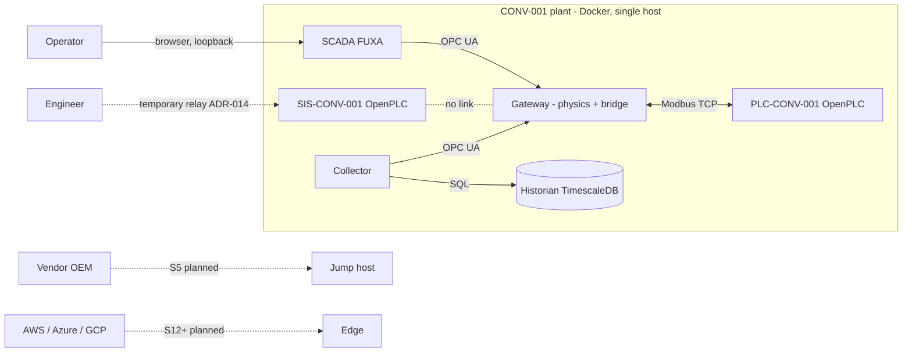

### 2.2 The containers — existence and wiring **[PROVEN]** (FF-22); ports **[WRITTEN]** from `docker-compose.yml`

| Service | Role | Network(s) | Host port (127.0.0.1) | Note |
|---|---|---|---|---|
| `plc-control` | PLC-CONV-001, OpenPLC v3: sequence + machine protection | `net_control` | 8081 (UI), 15020→502 (Modbus) | End-of-life (ADR-015) |
| `plc-safety` | SIS-CONV-001, OpenPLC v3: safety function | `net_safety` | 8082 (UI) | **Sole** member of its network (ADR-014) |
| `gateway` | Conveyor physics + OPC UA server + Modbus client to the PLC + modelled contactor | `net_control`, `net_supervisory` | 14840→4840 (OPC UA) | Only service spanning two zones |
| `scada` | FUXA (MIT, ADR-012), OPC UA client | `net_supervisory` | 1881 | |
| `historian` | TimescaleDB: samples + alarm history | `net_supervisory` | 15432→5432 | |
| `collector` | Reads OPC UA at 1 Hz, writes the historian, evaluates alarms | `net_supervisory` | none | |

Networks: `net_control` internal, `net_safety` internal, `net_supervisory` ordinary bridge. No published port off loopback (ADR-018, FF-22). **[PROVEN]**

### 2.3 Two operating modes — a frequent source of confusion

| | **PLC mode** | **Embedded mode** |
|---|---|---|
| Variable | `VIGILIMEN_PLC_LINK=modbus` (compose default) | `VIGILIMEN_PLC_LINK=off` (code default in `opcua_server.py`) |
| Who decides "Run" | The `conveyor.st` program inside OpenPLC | A Python model in the gateway |
| Use for | Normal operation, FF-27 | Tests without a PLC, FF-26 without Modbus |
| Trap | The PLC must have its program loaded or the signature ≠ 1 | Results not comparable with PLC mode |

The two defaults differ (compose = `modbus`, code = `off`). **[WRITTEN]** After every `docker compose up`, check the mode ("linked to plc-control:502, read-back clean" in the gateway log).

---

## 3. Collector, historian, edge: who does what, and why three

This is the question that produced the most confusion. Short answer: **three different jobs, three different failure modes, three different recipients.**

| | **Collector** | **Historian** | **Edge** (planned S5) |
|---|---|---|---|
| Nature | Python process (`plant/historian/collector.py`) | TimescaleDB (`plant/historian/schema.sql`) | Python process to be written (ADR-020) **[PLANNED]** |
| Verb | **Reads** the process and **evaluates** alarms | **Keeps** the local memory | **Pushes** off the site |
| Input | Gateway OPC UA, 1 Hz, source-timestamped | SQL from the collector | Gateway OPC UA (client, never writes) |
| Output | SQL rows (`sample`, `alarm_event`, `alarm_state`) | Data, 5-min/1-h views, immutable alarm history | MQTT messages (QoS 1) to the broker in the DMZ |
| If the WAN drops | No effect | No effect | Durable local queue (SQLite), replay on return |
| If it dies | No history or alarms; the plant keeps running | Collector fails; the plant keeps running | The cloud receives nothing; **the site keeps everything** |
| Needs the Internet | **No** | **No** | Yes, by construction |

**Why the edge is not merged into the collector/historian (s8C).** The enhanced CIRMP rule s8C requires the critical system to **operate independently for three months** while external systems are restored. **[WRITTEN]** If the edge *were* the collector, a WAN, broker or cloud failure would reach the local history and the alarms — exactly what s8C forbids. So the local chain (gateway → collector → historian) stays **untouched and with no outbound dependency**, and a separate outbound path is added beside it, one we accept may fail. This separation is **decided in writing** (ADR-020, draft) **[PLANNED]**; the three-month proof is planned for S26 **[PLANNED]**. On the target site the collector has no route out; FF-04 (planned) will check it **[PLANNED]**.

**Why a collector *and* a historian?** The collector is effectively stateless: it can restart in milliseconds because alarm state is stored *with* the history in the same transaction (ADR-019, FF-25). **[PROVEN]** The historian is the only thing that keeps data; restarting the collector must not rewrite history. **[PROVEN]**

**If you know AVEVA PI.** On PI, the interface and the Data Archive are usually thought of as one system, and in day-to-day use they are. The mapping here is: **collector ≈ PI Interface/Connector** (reads the source, stamps it, applies quality), **historian ≈ PI Data Archive** (stores and serves), and **edge ≈ PI Buffer Subsystem + Connector Relay / PI-to-cloud** (buffers and forwards off site). The difference is that PI's buffering sits *in front of* the archive on the same path, while here the outbound path is a **separate branch**: the local collector→historian chain is never made to depend on it. Here the collector additionally evaluates alarms (PI would do that in Notifications/Asset Framework analytics), which is why its restart behaviour matters (ADR-019). Treating collector+historian as one logical "local historian" is fine; the split is for code and failure isolation, not for a different purpose.

**Trap to avoid:** the edge is not "a second collector". It computes no alarm, stores only what it has not yet been able to send, and only publishes (no subscription: no downward command path, ADR-005). **[PLANNED]**

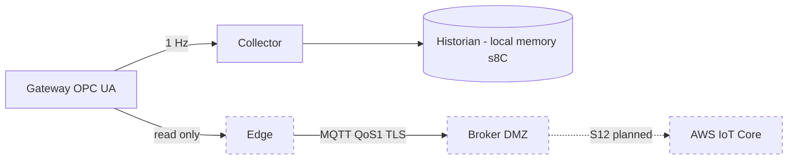

(Dashed = planned, does not exist.)

---

## 4. The safety function and the contactor

### 4.1 Principle (ADR-011) **[WRITTEN]**, logic **[PROVEN]** (FF-06, FF-21)

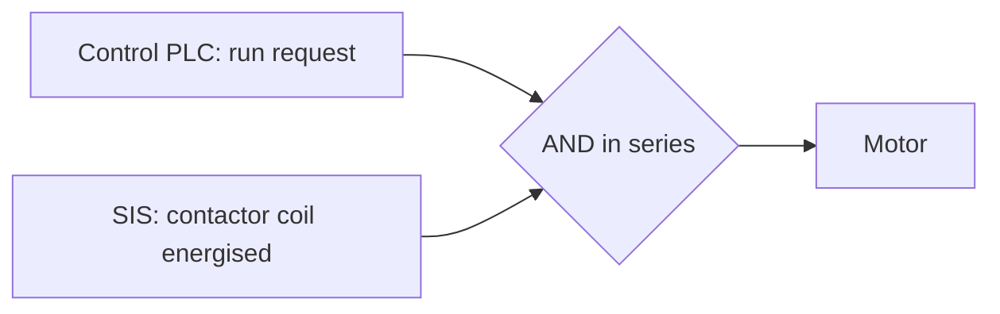

`motor turns = safety contactor energised AND control run request`. The control PLC can stop the belt; it cannot start it against a trip; the SIS stops it with the PLC absent, powered down, or commanding RUN.

### 4.2 How it is realised in the plant

- `plc-safety` has **no link of any kind** (single-member internal network). **[PROVEN]** FF-22 + `tools/prove-isolation.ps1`.
- Its contactor is a Python `SafetyFunction` (`plant/sim/interlock_model.py`) inside the gateway: the "series wiring" becomes one line of code (ADR-014). **[WRITTEN]**
- Engineering access to the SIS is a deliberate temporary human act: a throwaway container joins `net_safety` (`tools/plc-ui-relay.ps1 -Target safety -ConfirmSafety`) then is removed; the isolation check fails if one is left. **[WRITTEN]**
- `interlock_model.py` is a **model** of `safety.st`/`conveyor.st`, not the program. FF-21 reads `safety.st` on disk. **[PROVEN]** Not proven: that the program *running* in OpenPLC behaves as the model says for safety (only the control PLC has end-to-end proof: FF-27).

### 4.3 Control PLC state machine (`conveyor.st`) — trips **[PROVEN]** by FF-27

| `Plc_State` | Name | Note |
|---|---|---|
| 0 | stopped | |
| 1 | warning | bearing ≥ 85 °C (alarm) |
| 2 | starting | 10 s horn |
| 3 | running | |
| 4 | stopping | |
| 5 | fault | bearing ≥ 95 °C or current ≥ 42 A (machine trips) |

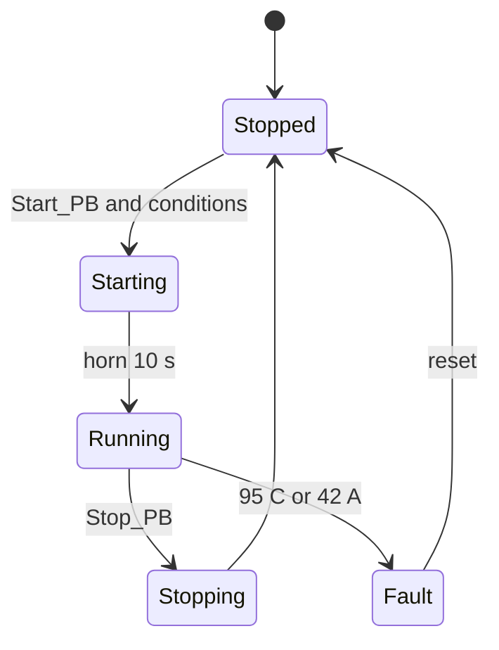

(Summary only; exact transitions are in `plant/plc-control/conveyor.st`.) **[WRITTEN]**

---

## 5. Interfaces

### 5.1 Modbus contract, gateway ↔ PLC (`plc_io_map.py`, ADR-013) — `MAP_VERSION = 1`

The **client is the gateway**; it plays the field (sensors, buttons) and reads the PLC's decisions.

| Name (conveyor.st) | IEC address | Type | Direction | Scale |
|---|---|---|---|---|
| Start_PB | %QX100.0 | BOOL | → PLC | |
| Stop_PB | %QX100.1 | BOOL | → PLC | |
| Zero_Speed | %QX100.2 | BOOL | → PLC | |
| Upstream_Ready | %QX100.3 | BOOL | → PLC | |
| Downstream_Ready | %QX100.4 | BOOL | → PLC | |
| Bearing_Temp_x10 | %QW100 | UINT | → PLC | ×10 (°C) |
| Motor_Current_x10 | %QW101 | UINT | → PLC | ×10 (A) |
| Belt_Speed_x100 | %QW102 | UINT | → PLC | ×100 (m/s) |
| Motor_Run | %QX101.0 | BOOL | PLC → | |
| Alarm_Horn | %QX101.1 | BOOL | PLC → | |
| Alarm_Word | %QW110 | WORD | PLC → | |
| Plc_State | %QW111 | UINT | PLC → | |
| Plc_Map_Version | %QW112 | UINT | PLC → | signature |

`conveyor.st` ↔ map consistency: **[PROVEN]** FF-23.

**Three behaviours that are the point of `plc_link.py`** — **[PROVEN]** by FF-24 against a fake OpenPLC; **[PROVEN]** by FF-27 against the real one:
1. **Loss of the PLC = no run request** (fail-safe); no answer means "not running".
2. **Signature first.** OpenPLC v3 *stores* a Modbus write to an address no program locates and reads it back without error (measured 25 Oct). A read-back proves nothing; only `Plc_Map_Version` proves the right program is running. Not detected at run time: a program with the right signature that lacks one input (FF-23 catches that at commit).
3. **Never block the OPC UA loop**: rate-limited reconnects, exchange in a worker thread.

### 5.2 Gateway OPC UA address space **[WRITTEN]** (`opcua_server.py`)

Read-only: `Running`, `SafetyTripped`, `BeltSpeed_mps`, `Load_tph`, `BearingTemp_C`, `Vibration_mms`, `MotorCurrent_A`, `PlcLinkOK` (i=20), `PlcState` (i=21), `PlcAlarmWord` (i=22).
Writable: `StartCommand`, `StopCommand`, and the five fault-injection tags `FaultBearingWear`, `FaultBeltSlip`, `FaultMisalignment`, `FaultIdlerSeizure`, `FaultVibrationSpike` (i=15..19, ADR-016, clamped 0..1; spike 0..10 mm/s; NaN → 0).

**Evolution rule:** **append at the end, never insert**: asyncua numbers nodes in creation order and FUXA binds `ns=2;i=N`. **[WRITTEN]**

**Accounts (`historian`, `engineer`).** Same role: the difference is **attribution**, not **authorisation** (ADR-017). Accepted consequence: a compromised collector can write `StartCommand`. **[WRITTEN]**, a known limit (see D-06).

### 5.3 Historian schema **[WRITTEN]** for the DDL, **[PROVEN]** for immutability (FF-28) and persistence (FF-25)

| Object | Role |
|---|---|
| `asset`, `tag` | Asset hierarchy and signal definitions (ISA-95) |
| `sample` | Hypertable, 1-day chunks, compression at 7 days, **90-day retention** |
| `sample_5m`, `sample_1h` | Continuous aggregates |
| `alarm_event` | Transition history, **append-only** (triggers refuse UPDATE/DELETE/TRUNCATE), **outside** the hypertable to escape retention; `actor` column |
| `alarm_state` | Current state of each alarm, written in **the same transaction** as the events (ADR-019) |
| `sample_aest` | Display view in Brisbane time (ADR-010) |

Time rule (ADR-010): everything a machine writes is **UTC**; everything a human reads is **Australia/Brisbane (AEST, UTC+10, no daylight saving)**. Conversion at presentation only. **[WRITTEN]**

### 5.4 One sample, end to end

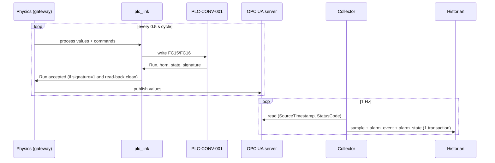

Three collector decisions **[WRITTEN]**: **source** timestamp (not insert time), **quality carried** (192 good / 64 uncertain / 0 bad), and the code **only reads** (a property of the code, not of the account).

---

## 6. The alarm engine (S4, ISA-18.2) — `plant/alarms/engine.py`

States: `NORMAL`, `UNACK`, `ACKED`, `RTN_UNACK`, `SHELVED`, `SUPPRESSED`, `OOS`. **[WRITTEN]** for the definitions; transitions **[PROVEN]** by FF-07 (model), FF-25 (persistence across restart), FF-26 (running stack), FF-28 (restart during SHELVED, expiry, tamper refusal).

Configured alarms (each has deadband and on-delay) **[WRITTEN]**:

| Tag | Condition | Limit | Priority | On-delay |
|---|---|---|---|---|
| BearingTemp_C | HI / HI_HI | 85 / 95 °C | HIGH / URGENT | 10 s / none |
| Vibration_mms | HI / HI_HI | 4.5 / 7.1 | LOW / HIGH | 30 s / none |
| Current_A | HI / HI_HI | 38 / 42 A | LOW / HIGH | 5 s / none |
| Speed_mps | LO / LO_LO | 2.0 / 0.1 | LOW / HIGH | 15 s / none |

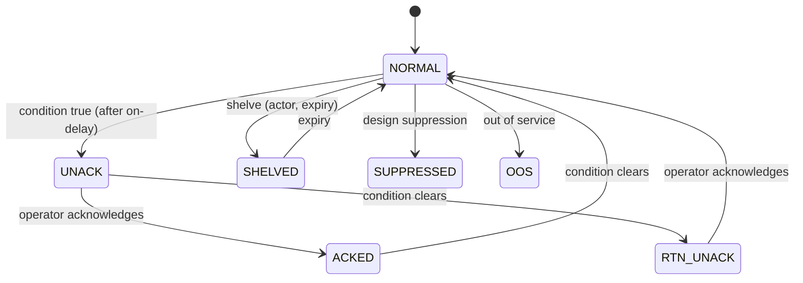

(Simplified; `engine.py` is the authority.) **Open decision:** no event is produced when the condition clears *during* SHELVED — ISA-18.2 behaviour not verified.

Why this is a "manipulable surface": S8 will shelve, suppress and take alarms out of service as an attacker would; the history records the `actor` precisely so that "who shelved it, and when" has an answer (S24).

---

## 7. Security zones and the target (S5 DMZ)

### 7.1 Today **[PROVEN]** (FF-22)

| Zone / network | Members | Property |
|---|---|---|
| `net_safety` (internal) | plc-safety | Single member; no route in or out |
| `net_control` (internal) | plc-control, gateway | No route off the host |
| `net_supervisory` (bridge) | gateway, scada, historian, collector | Ports published on 127.0.0.1 only |

### 7.2 Target at S5 — design only **[PLANNED]** (`docs/architecture/dmz-target.md`, ADR-020, ADR-021, drafts)

> **V4.1 (30 Oct 2026, proposed):** the diagram below is the 26 Oct draft. ADR-023 (draft) adds `fw-cell` between the cell and `net_supervisory`, moves the gateway to `net_control` only, and has the edge and collector read `opcua-sup`. See Appendix C and `docs/architecture/dmz-target.md` section 7.

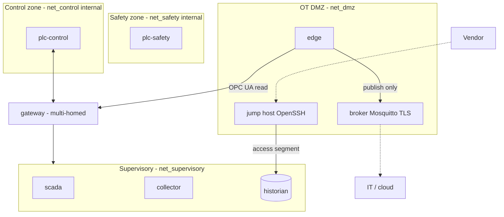

Key design facts established from the real compose **[WRITTEN]**:
- Docker ignores published ports on `internal` networks, and a DMZ the host must reach cannot be `internal`.
- ADR-017 means a read-only OPC UA account is impossible today; the first brokered-access target is therefore the historian via a read-only PostgreSQL role.
- The delivery plan's "only the broker crosses" is not literally achievable: the multi-homed set is {gateway, edge, jump, historian}.
- Forbidden: any path from IT/DMZ to `net_control`/`net_safety`; any subscription by the edge; any shell access to the SIS.

---

## 8. Fitness functions (FF) catalogue

Rule: **the scripts in the repository are the numbering authority.** 16 numbered; 13 run in CI; FF-26/27/28 need Docker and run outside CI.

| FF | Checks | Where | Status |
|---|---|---|---|
| FF-01 | Governance documents stay under the cut line | `ff01_doc_cut_line.sh` | CI |
| FF-02 | Terraform formatted and valid | `ci.yml` step (no script) | CI |
| FF-03 | No static cloud credential in the tree; workflows request OIDC | `ff03_no_static_credentials.sh` | CI |
| FF-05 | Naming and tagging (tag drives teardown) | `ff05_naming_and_tagging.sh` | CI |
| FF-06 | Safety independence (model) | `ff06_safety_independence.py` | CI |
| FF-07 | Alarm state model is ISA-18.2-shaped | `ff07_alarm_state_model.py` | CI |
| FF-13 | Terraform plan has nothing on the never-create list | `ff13_denylist.py` | CI |
| FF-14 | Federation trust conditions stay narrow | `ff14_federation_scope.sh` | CI |
| FF-21 | `safety.st` on disk matches FF-06's argument | `ff21_safety_st_static.py` | CI |
| FF-22 | Compose still draws the zones (3 networks, 6 services, loopback ports) | `ff22_compose_topology.py` | CI |
| FF-23 | `conveyor.st` ↔ gateway I/O map agree | `ff23_plc_io_map.py` | CI |
| FF-24 | Gateway drives PLC and fails safe (fake OpenPLC) | `ff24_gateway_plc_link.py` | CI |
| FF-25 | Collector restart does not rewrite alarm history | `ff25_alarm_persistence.py` | CI |
| FF-26 | Running stack end to end | `ff26_stack_e2e.py` | Docker only |
| FF-27 | Real OpenPLC machine-protection trips (42 A, 95 °C) | `ff27_plc_trips_e2e.py` | Docker only |
| FF-28 | Alarm history survives tamper and restart during SHELVED | `ff28_alarm_durability.py` | Docker only |

Planned **[PLANNED]**: FF-04 (no OT container has an Internet route), FF-20 (supply chain: digests, SBOM, scan), FF-29 (WAN-outage resilience), proposed FF-30 (remote-access scenario with negative steps) and a broker ACL check. FF-22 must be extended at S5 (it freezes 3 networks and 6 services today).

---

## 9. Technical challenges register

| ID | Challenge | State |
|---|---|---|
| D-01 | OpenPLC v3 stores Modbus writes to unlocated addresses; read-back is blind | Handled by signature register **[PROVEN]** (FF-24/27) |
| D-02 | Safety physical independence cannot be shown in software; contactor is a Python model | Open; witnessed test (SAT) planned S9 |
| D-03 | Model vs real program drift (`interlock_model.py` vs `.st`) | Partly mitigated (FF-21, FF-23); safety ST not run against vectors **[WRITTEN]** |
| D-04 | MatIEC rejects VAR blocks mixing located and plain variables | Worked around in `.st` |
| D-05 | OpenPLC lost its program after a rebuild (cause unchecked) | Open; program reloaded by hand |
| D-06 | ADR-017: all OPC UA accounts can write `StartCommand`/`Fault*` | Accepted; fix needed before the edge (Q2) |
| D-07 | Docker internal networks ignore published ports; DMZ cannot be internal | Design constraint for S5 |
| D-08 | `net_supervisory` internal+relays vs routable (FF-04) | Open question Q1 |
| D-09 | Store-and-forward correctness (dedupe, ordering, bounded queue) | Planned S5, FF-29 |
| D-10 | Hardware MFA cannot be demonstrated in a lab | Policy configured only (ADR-021) |
| D-11 | ISA-18.2 behaviour when condition clears during SHELVED | Open decision |
| D-12 | OpenPLC is EOL (ADR-015) | Accepted, recorded |
| D-13 | Mode mismatch (compose `modbus` vs code `off`) | Check logs after each up |
| D-14 | Script overwritten from an old copy (26 Oct) | Rule: re-read file and check mtime before writing |
| D-15 | Documentation over-engineering | FF-01 cut line |
| D-16 | Cloud cost surprises | ADR-004 (ephemeral windows, FF-13 deny-list) |
| D-17 | The collector connects to TimescaleDB as the database owner (`vigilimen`); no least-privilege roles | Open; needed anyway for the read-only vendor role (ADR-021), proposed for S5 |
| D-18 | OPC UA channel runs with `NoSecurity` (no signing or encryption); password transport not verified | Open; certificates and a signed, encrypted policy are a hardening item |

---

## 10. ADR catalogue

| ADR | Decision | Status |
|---|---|---|
| 001 | Three clouds split by verb (AWS senses, Azure acts, GCP learns) | Accepted |
| 002 | Modular monolith for the enterprise plane | Accepted |
| 003 | Simulated plant is the System under Consideration | Accepted |
| 004 | Cost control by construction (ephemeral cloud windows) | Accepted |
| 005 | OT boundary unidirectional by default | Accepted |
| 006 | Which regulations apply to a mine (voluntary CIRMP build) | Accepted |
| 007 | Federated identity only; no static cloud credential | Accepted |
| 008 | Entra ID as identity authority for all clouds | Accepted |
| 009 | Nominate AESCSF, map IEC 62443 beneath | Accepted |
| 010 | Machine time UTC; human time Australia/Brisbane | Accepted |
| 011 | Safety function is a separate controller | Accepted |
| 012 | FUXA for SCADA (licence decision) | Accepted |
| 013 | Gateway plays the field, drives PLC over Modbus | Accepted |
| 014 | SIS stays unlinked; contactor modelled in gateway | Accepted |
| 015 | OpenPLC v3 is EOL and used anyway | Accepted |
| 016 | Fault injection tags in gateway address space | Accepted |
| 017 | OPC UA accounts: attribution, not authorisation | Accepted |
| 018 | Demo credentials scope | Accepted |
| 019 | Alarm state persistence | Accepted |
| 020 | Edge stack (separate 7th service, MQTT, store-and-forward) | **Proposed** (draft) |
| 021 | Brokered remote access (jump host, short-lived SSH certs) | **Proposed** (draft) |
| 022 | Diagramming tools (draw.io, Archi, Mermaid) | **Proposed** |
| 023 | Cell firewall and read-only supervisory OPC UA server (`fw-cell`, `opcua-sup`) | **Proposed** (draft 30 Oct) |

Next free ADR number: 024. Planned numbers: passive-first discovery (S6), zone partitioning as consequence (S7), FAT hold-point criteria (S9) — next free numbers at write time.

---

## 11. Roadmap S5–S29

| Sprint | Theme | Key outputs |
|---|---|---|
| S5 | Edge, OT DMZ, brokered vendor access | Edge, broker, jump host, store-and-forward, WAN test, SBOM/scan; **gate M1** |
| S6 | OT network visibility and asset inventory | Passive-first discovery, inventory |
| S7 | IEC 62443-3-2 risk assessment (ZCR 1–7) | Zones, conduits, SL-T, CRS |
| S8 | ATT&CK for ICS: attack, detect, measure | Scenarios against the plant, detection coverage |
| S9 | FAT/SAT cybersecurity validation | Hold points, witnessed safety test |
| S10 | Procurement and supply-chain assurance | |
| S11 | CIRMP pack, incident response, tabletop | AESCSF SP-2, OT IRP; **gate M3** |
| S12–S14 | AWS industrial data plane (IoT Core, SiteWise, lake) | **Gate M4** |
| S15–S18 | Azure enterprise plane (monolith, APIM, Angular, integration) | **Gate M5** |
| S19–S21 | ML: SageMaker, GCP warehouse, Vertex | **Gate M6** |
| S22–S23 | GenAI assistant + Power Platform; BI | **Gate M7** |
| S24 | OT SOC across IT and OT | |
| S25 | Observability and SLOs | |
| S26 | DR, chaos game-days, three-month independence proof (s8C) | |
| S27 | FinOps, governance, compliance | |
| S28 | Two demonstrations | |
| S29 | Portfolio packaging and close | |

Cadence: 3-week roster cycles (one 56 h heavy week + two 7 h weeks), M3 early Feb 2027, runway to early 2028 (delivery plan v2.1). Gate M2 and the exact milestone dates are in `pilotage/delivery-plan.md`.

---

## 12. Glossary

| Term | Meaning here |
|---|---|
| **SUC** | System under Consideration — the simulated conveyor |
| **`fw-cell` / firewall C** *(V4.1, proposed)* | The cell firewall: one nftables container in the lab, a DIN-rail industrial firewall (BOM-021) on the physical design. The single door between the cell (Z1) and supervisory (Z2). |
| **`opcua-sup` / OT-OPC-01** *(V4.1, proposed)* | A read-only OPC UA server in Z2 serving measurements and `Plc*` status, with no command or fault node. Everything that only reads reads this. |
| **Zone ZS** *(V4.1, proposed)* | The safety zone (SIS) in the zone and conduit register, with no conduit. |
| **Conduit C1 / C2 / C3 / CM** *(V4.1, proposed)* | C1 `fw-cell`; C2 firewall A (Z2 to Z3); C3 firewall B (Z3 to Z4); CM management. |
| **PLC / SIS** | Programmable logic controller (control) / safety instrumented system (protection) |
| **Gateway** | Container that simulates the field and bridges Modbus ↔ OPC UA |
| **Collector** | Reads OPC UA at 1 Hz, writes the historian, evaluates alarms |
| **Historian** | TimescaleDB: local memory of samples and alarm history |
| **Edge** | (Planned) outbound publisher: OPC UA client → MQTT; never writes |
| **Zone / conduit** | IEC 62443 groupings of assets / the controlled paths between them |
| **SL-T / SL-C / SL-A** | Target / capability / achieved security level |
| **s8C** | CIRMP enhanced rule: critical system operates independently for three months |
| **CIRMP** | Critical Infrastructure Risk Management Program (Australia, SOCI) |
| **AESCSF** | Australian Energy Sector Cyber Security Framework |
| **FF** | Fitness function — an automated check that an architectural property still holds |
| **ADR** | Architecture Decision Record |
| **FAT / SAT** | Factory / Site acceptance test |
| **ISA-18.2** | Alarm management standard |
| **TRITON** | Malware that targeted a safety system; origin of ADR-011's rule |
| **Store-and-forward** | Local durable queue that holds messages while the WAN is down |
| **Jump host** | Hardened host in the DMZ through which vendors reach one asset |
| **Published port** | A port opened from the host into a container; ignored by Docker if all the container's networks are internal (A.4) |
| **Internal network** | Docker network with no route out (A.2) |
| **Relay** | Small forwarder that connects two sides without understanding the traffic (A.5) |
| **DMZ** | Demilitarised zone (A.6) |

---

## 13. What is not yet proven (honest list)

- Physical independence of the safety function (D-02); the SIS program running in OpenPLC against test vectors.
- ISA-18.2 behaviour when a condition clears during SHELVED (D-11).
- Why OpenPLC lost its program after a rebuild (D-05).
- Everything in S5 and later: edge, broker, jump host, WAN resilience, remote-access scenarios, hardware MFA.
- The three-month independence claim (S26).
- Everything in Appendix C (V4.1): nothing is built; SL-T values are placeholders until S7; a container firewall shows the policy, not the DIN-rail device.

## 14. Open decisions for E. Zaré

Q1 net_supervisory internal + relays vs routable; Q2 edge account / ADR-017 fix; Q3 deadbands and WAN test load; ADR-021 first target and hardware key; SHELVED-clear behaviour; commit of ADR-020/021/023, `dmz-target.md`, `diagram-plan.md` and this spec. **Q5 (30 Oct): accept, amend or refuse ADR-023** (cell firewall and read-only `opcua-sup`); it answers Q2 if accepted. Then: re-draw D1 in draw.io.

---

## Appendix A. Beginner's briefing: networks, Docker, DMZ, ports and relays

Read this first if the network vocabulary in sections 2 and 7 is new. Each point answers one "why" in plain words. Marks follow the same rule as the rest of the document.

### A.1 Why is the plant built on Docker?

**What Docker gives us.** A container is a small, isolated computer-like process. Each of the six plant parts (control PLC, safety PLC, gateway, SCADA, historian, collector) runs in its own container. Docker also lets us create virtual networks and decide which container sits on which. A network here plays the role of a cable or a VLAN. `docker compose up` rebuilds the whole plant from one file, so it can be attacked, broken and rebuilt in an afternoon.

**Why not real hardware.** ADR-003: a PLC, an industrial switch and a panel would cost more than the whole US$333 budget several times over, and a simulated plant can be attacked (ATT&CK for ICS techniques) without breaking hardware or a vendor's terms.

**What Docker cannot prove.** Docker networks are software. All containers share one host and one kernel, there is no real switch, no real wiring, no real firewall appliance. So the project shows that the *design* holds (who can talk to whom), not that real hardware is secure. The README and spec must keep saying so. [WRITTEN, ADR-003 honest limitation]

### A.2 Vocabulary you need for the network questions

| Term | Meaning, with the plant as the example |
|---|---|
| **Host** | Your Windows PC. The containers run on it. |
| **Container** | One plant part, e.g. `scada`. |
| **Port** | A numbered door on a machine. FUXA listens on door 1881 inside its container. |
| **Loopback, 127.0.0.1** | "This machine only". A service published on loopback can be opened from your PC but not from other computers. |
| **Docker network** | A virtual cable that connects the containers placed on it. Containers on different networks cannot see each other. |
| **Bridge network** | The default kind. Containers on it can talk to each other and also reach the outside world through the host. |
| **Internal network** (`internal: true`) | A bridge network with no way out. Containers on it can talk to each other and nothing else, not even your PC, not the Internet. |
| **Published port** (`ports:` in compose) | A hole drilled from the host into a container, e.g. `127.0.0.1:1881 -> scada:1881`. It is how you open the SCADA screen in your browser. |
| **Route** | The path a message follows to leave a network. "Has a route" means a way out exists. |

### A.3 What "routable" and "internal" mean for the three plant networks

Think of three rooms in a building.

| Network | Today | Meaning |
|---|---|---|
| `net_safety` | internal, one member | A locked room with one person. No door to anywhere. [PROVEN: FF-22] |
| `net_control` | internal | A locked room with the PLC and the gateway. No door out. [PROVEN: FF-22] |
| `net_supervisory` | **bridge (routable)** | A room with a door to the street. SCADA, historian, collector and gateway all have it. |

**Q1 asks whether to lock that third door.** Locking it (making the network internal) makes the statement "no OT container can reach the Internet" true for every room. The price is the next point.

### A.4 The Docker rule that makes Q1 awkward

Docker ignores published ports for a container whose networks are *all* internal. In room terms: a locked room cannot also have a window onto the street. Today you open FUXA at 1881 because `net_supervisory` has a door. Lock the door and 1881, 15432 (historian) and 14840 (gateway) stop working from your PC. [PROVEN for the OpenPLC web pages (ADR-013, ADR-014); NOT yet tested for `net_supervisory`]

### A.5 Relays and proxies

**A relay is a tiny program that listens on one side and passes everything to the other side.** The plant already uses one: `plant/tools/plc-ui-relay.ps1` starts a throwaway container (running `socat`) that is attached to the internal network *and* publishes a port on your loopback. It forwards your browser's requests to the OpenPLC page and brings the answer back. When you stop it, the window closes again. It exists because the PLC networks are internal and the PLC pages could otherwise not be opened at all. The script also shows the safety rule: a relay on `net_safety` is a second member of that network, so it needs `-ConfirmSafety` and must be stopped afterwards (ADR-014).

**Is a relay the same as a proxy?** Same family, different job:

| | Relay | Proxy | Reverse proxy |
|---|---|---|---|
| What it does | Copies bytes between two ends, unaware of the content | Acts on behalf of a client, can read, filter, log and authenticate | Acts on behalf of a server, sits in front of it |
| Plant example | `socat` in `plc-ui-relay.ps1` | none yet | the jump host (S5) behaves like a guarded gateway to one asset |
| Smarts | none | policy | policy, TLS, login |

So a relay is the simplest kind of proxy. The security point is that every relay is a deliberate, named hole. That is why it is acceptable to open one by hand for a lab session and unacceptable to leave one running.

**Why would FUXA need a relay under option A?** Only so that *you* can open its screen from your PC. Inside the plant nothing changes, because the other containers still reach it over the internal network. The relay is the price of convenience, and in the real design it is replaced by access through the DMZ (jump host, ADR-021).

### A.6 Why data may leave OT only through a DMZ

**DMZ = demilitarised zone**, borrowed from the military term for a buffer strip between two sides. In networks it is a small zone between the trusted inside (OT, the plant) and the less trusted outside (IT, cloud, vendors) where neither side trusts the other and every crossing is controlled.

**Why a single controlled crossing.**

1. **A plant is built to run, not to be patched often.** PLCs run for years on old firmware. They must not be reachable from systems that are patched and attacked daily.
2. **Real incidents show what direct paths cost.** The Oldsmar water plant (2021) was changed remotely through shared remote-access credentials. The 2015 Ukraine grid attack came in through the IT network and moved into control systems. TRITON (2017) went for a safety system. Each case is a path from outside to a controller. (These are cited in the threat model and ADR-011, ADR-005; check the primary reports before you quote them in an interview.)
3. **One door is easier to guard than many.** Logging, filtering, authentication and "who approved this" all live at one place, and one test (FF-04, FF-22) can prove no other door exists.
4. **The standard asks for it.** IEC 62443 groups assets into *zones* and the controlled paths between them into *conduits*, each with a target security level (SL-T).

**What the S5 DMZ holds.** The `broker` (receives the edge's data), the `jump` host (the only way a vendor reaches one asset), and the `edge` straddles OT and DMZ. Rule of the design: the edge connects outward and publishes only; nothing in the DMZ may open a connection back into OT. [PLANNED, ADR-020, ADR-021, dmz-target.md]

**Simulation caveat.** In Docker the DMZ network cannot be `internal` if your PC must reach the broker and the jump host (section A.4), so the simulated DMZ has a route a real one would deny. This is recorded as a limitation (dmz-target.md 3.2).

### A.7 Worked example: a vendor needs to read the historian

Without a DMZ: the vendor gets a VPN into the plant network and sees everything. With the design:

1. The vendor asks for access. The operator approves a time window.
2. A short-lived SSH certificate is issued; the vendor connects to `jump` from outside.
3. `jump` sits on a separate network with only the historian on it, using a read-only database role.
4. The session is recorded. If recording fails, the session closes.
5. Time runs out or the operator terminates: access ends and the certificate is revoked.

Each step is a test target (FF-30 proposed). [PLANNED, ADR-021]

### A.8 Extra vocabulary that the S5 documents use

| Term | Plain meaning |
|---|---|
| **Firewall** | Rules that allow or block connections between networks. Docker networks play this role in the lab. |
| **Purdue model** | A layering of industrial networks: levels 0-1 devices and PLCs, 2 supervisory, 3 site operations, 4-5 enterprise. The DMZ sits between 3 and 4. |
| **Publish / subscribe, MQTT, broker** | The edge *publishes* messages to a *topic*; consumers *subscribe*. The broker is the post office in between. |
| **QoS 1** | MQTT promise that a message is delivered at least once, so duplicates are possible and must be removed (dedupe on `edge_id, seq`). |
| **TLS** | Encryption and server identity for a connection. |
| **SSH certificate** | A short-lived signed key instead of a permanent password. |
| **MFA** | A second proof of identity, e.g. a hardware key. |
| **Image digest** | A fingerprint of a container image; pinning by digest means "exactly this build". |
| **SBOM** | Software bill of materials: the list of what is inside an image. |
| **Attribution vs authorisation** | Knowing *who* did something (accounts) versus limiting *what* each account may do (roles). ADR-017 has only the first. |
| **Deadband** | The smallest change worth reporting. A temperature moving 0.1 °C is not sent. |
| **Report by exception** | Send a value only when it changes by more than its deadband, plus a periodic heartbeat. |

### A.9 How to decide Q1 as a beginner

1. Write the sentence you want to defend: "No OT container can reach the Internet."
2. List what you use through the three host ports and how often.
3. Option A: the sentence is true everywhere; you add a relay or use the DMZ path for those uses.
4. Option B: you keep today's convenience; the sentence must be shortened to the two internal networks, in the ADR and in interviews.
5. Run the Docker check from dmz-target.md 3.2 before relying on any claim about ports.
6. Record the choice and the reasoning in ADR-020 Q1.

### A.10 The three new S5 services: `edge`, `broker`, `jump`

None of them exists yet. They are the S5 design (ADR-020, ADR-021, `dmz-target.md`). [PLANNED]

| Service | What it is | Plain analogy | What it does | What it must never do |
|---|---|---|---|---|
| **`edge`** | A small Python program, the 7th container. An OPC UA *client* of the gateway and an MQTT *publisher*. | A courier who copies the plant's readings and carries them to the post office. | Reads the gateway (read only), filters (report by exception), keeps unsent messages in a local SQLite queue, publishes them to the broker. | Write to the plant, subscribe to anything, accept a connection from outside. |
| **`broker`** | Mosquitto, an MQTT server, with TLS and access rules. Lives in the DMZ. | The post office: receives from the courier, hands over to whoever is allowed to collect. | Accepts publishes from the edge, lets IT consumers (later AWS IoT Core) subscribe. | Let anyone but the edge publish to the edge's topics; open a connection into OT. |
| **`jump`** | OpenSSH server, hardened, in the DMZ. A *jump host* (also bastion). | A guarded visitor entrance with a logbook and a camera. | The only way a vendor reaches one asset (the historian, read-only): named account, short-lived SSH certificate, operator approval, recorded session. | Reach the gateway, the PLCs, SCADA or the collector; keep a session without a recording. |

How they connect:

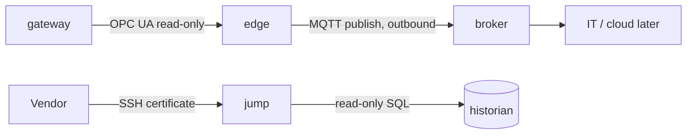

Why three and not one: they serve three different people (the cloud, the IT consumer, the vendor), have different failure modes, and must not share a network or an account. The edge goes out, the vendor comes in, and keeping those two paths in separate containers means a flaw in one gives no route onto the other. Why in the DMZ: so neither can be used as a stepping stone into `net_control` or `net_safety`.

### A.11 The whole chain, end to end

Two views. The first shows who is connected to whom and by which protocol. The second follows one action, pressing START, through every hop.

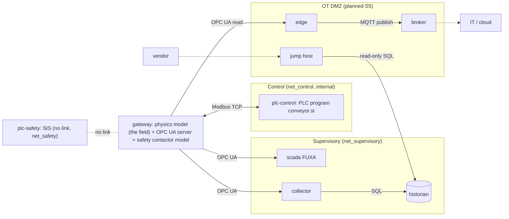

The gateway is the only place where the two worlds meet. On one side it speaks **Modbus** to the PLC, playing the part of the field wiring (buttons and sensors). On the other side it speaks **OPC UA** to everything that supervises or records. Everything else in the plant reaches the PLC only through it.

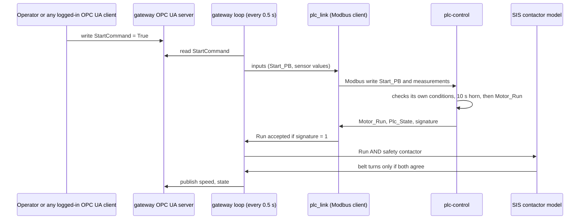

Read as a story: START is only a **request**. The PLC decides whether to run. The SIS can still stop the belt regardless. Nothing in this chain lets an OPC UA client change the PLC program or skip its conditions.

### A.12 Why OPC UA, and why Modbus as well

| | **Modbus TCP** | **OPC UA** |
|---|---|---|
| Age and role | 1979 serial heritage; the common language of PLCs and field devices | Modern standard for supervisory and information-level data |
| Identity | None at all: any client that can reach the port can read and write | Authenticated sessions with accounts or certificates; encryption available |
| Data | Raw numbered registers and coils; meaning exists only in a document | Named, typed nodes in a browsable address space |
| Time and quality | None | Source timestamp and status code on every value |
| Used here | Gateway to PLC only (`plc_link.py`) | Gateway to SCADA, collector and edge |

**Why the PLC speaks Modbus.** OpenPLC offers it, and it is what real small PLCs and drives speak. The project's first principle is that this protocol authenticates nobody, so the only protection is **where it is allowed to travel**: it stays inside `net_control`. [WRITTEN]

**Why everything above the PLC uses OPC UA.** The historian needs source timestamps and a quality code with each value (otherwise stored history cannot be trusted). SCADA and the edge need named tags, not register numbers. And an authenticated session gives an audit trail. That is what ADR-016, ADR-017 and the collector's design rely on. [WRITTEN]

> **V4.1 (proposed):** the edge reads `opcua-sup`, not the gateway. The reasoning below still holds (OPC UA, not Modbus).

**Why the edge reads OPC UA and not the PLC.** The edge sits at the border of OT. If it could speak Modbus to the PLC it would have to be on `net_control`, which would put the most exposed program inside the most protected zone. As an OPC UA client of the gateway it stays on the supervisory side. [PLANNED, ADR-020]

**Honest limitation.** In a real plant the OPC UA server usually runs on or beside the PLC or an OPC server, not inside a field simulator. Here the gateway does both jobs, so it is the simplified stand-in for the whole control-to-supervisory boundary.

### A.13 The DMZ is not the broker

The **DMZ** is a *zone*: a network segment, a place. The **broker** is one *program* that runs in that place. A building analogy:

| Thing | Building analogy | In S5 |
|---|---|---|
| DMZ (`net_dmz`) | The lobby between the street and the offices | A Docker network with its own rules |
| `broker` | The mail counter in the lobby | Mosquitto, receives what the edge publishes |
| `jump` | The reception desk with a visitor log | OpenSSH, the only way a vendor reaches one asset |
| `edge` | A courier who has a pass for both the office floor and the lobby | Reads the gateway, publishes to the broker |

A DMZ normally holds several services. What defines it is the rule that nothing in it is trusted by either side and every crossing is controlled.

### A.14 How can an OPC UA account matter if the PLC is reached over Modbus?

The attacker does not need to touch the PLC. The **gateway does it for them**.

1. The gateway reads the tag `StartCommand` from its own OPC UA server every 0.5 s (`opcua_server.py`).
2. It passes the value to `plc_link`, which writes `Start_PB` to the PLC over Modbus (`plc_link.py`, `plc_io_map.py`).
3. Any logged-in OPC UA session can write `StartCommand`, `StopCommand` and the five `Fault*` tags (ADR-017: write permission belongs to the node, not the account). So a program that only needs to read can still press START.

What an attacker gets by writing those tags:

- **A command request:** press START or STOP. The PLC still applies its own conditions (neighbours ready, belt at zero speed, no active trip) and the 10-second horn, and the SIS can still stop the belt (ADR-011).
- **False process values:** the `Fault*` tags change the simulated bearing, current, belt and vibration values that are sent to the PLC as sensor inputs. That can cause false trips or hide a real condition. These tags are a **simulation feature** (ADR-016). In a real plant the equivalent is spoofing a measurement or a setpoint through the SCADA or OPC server path.

What an attacker does **not** get from the OPC UA account: the PLC's program, direct Modbus access, or the safety function. The control PLC is not reachable except through the gateway, and the SIS has no link at all.

So "a path into the control loop" means: from any compromised OPC UA client there is a path to **influence the PLC's inputs**, not to take it over. That is still serious. It is exactly how a compromised SCADA or historian client becomes an operational risk, which is why the edge, which faces the DMZ, matters.

### A.15 Q2 (the edge account) in one paragraph [draft recommendation, not a decision]

> **V4.1 (30 Oct 2026):** the second OPC UA instance named below is now proposed as ADR-023 (draft). If accepted, the Q2 recommendation here is replaced: the edge cannot write because `opcua-sup` has no writable node.

Because of the mechanism in A.14, an `edge` account that is attribution-only can still press START. Option A removes that by giving the edge a path that has no writable nodes (ADR-017's cheapest fix is a second OPC UA instance exposing measurements only). Option B accepts the limit for S5 and leans on controls around it: no write call in the edge code (static check), no inbound connection to the edge, and a behavioural alarm (the edge never writes, so its first write is the signal). The recommendation is B for S5 and the second OPC UA instance after S8 has attacked the weakness, so the portfolio can show attack, fix and retest. The residual risk and the date of the fix are written into ADR-020 and the conduit register. The decision is E. Zaré's.

### A.16 Where the data lives and how it moves (the practical picture)

OPC UA is not a database and not where data is stored. It is the **front desk** of the gateway: a standard way to ask the gateway "what is the value of this thing right now?". The data itself sits in different places depending on how old it is.

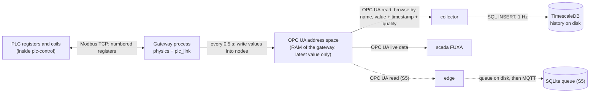

| Where | What it holds | How long | Lost on restart? |
|---|---|---|---|
| **PLC** (`plc-control`) | The registers the Modbus map describes (Start_PB, Bearing_Temp_x10, Motor_Run, Plc_State...). Numbers with no names or units, except in the map document. | Now only | Program and state must be reloaded (D-05) |
| **Gateway, OPC UA address space** | A tree: Enterprise / PilbaraSite / ProcessingArea / ConveyingCell / CONV001 / each tag. Each tag is a *node* holding its **latest value** only. Rewritten every 0.5 s. | Now only | Yes, rebuilt from the PLC and physics |
| **TimescaleDB** (`historian`) | Every sample at 1 Hz with its source timestamp and quality, plus alarm history. | Samples 90 days, 5-min and 1-hour summaries, alarm history kept | No, it is on a Docker volume |
| **Edge queue** (S5, planned) | Messages not yet delivered to the broker. | Until delivered | No, on disk |

**What "reading a tag" does in practice** (the collector, `collector.py`):
1. It connects to the gateway at `opc.tcp://gateway:4840` with the `historian` account.
2. It walks the tree by **name** (Enterprise, PilbaraSite, ... CONV001, BearingTemp_C) once at start-up and keeps the node handles.
3. Every second it reads each node. The answer is three things: the value (say 61.3), the source timestamp, and a status code (good, uncertain or bad).
4. It writes one SQL row per tag into TimescaleDB with that timestamp and quality.

**What "writing a tag" does:** a client with a session writes a writable node (`StartCommand`). The gateway loop reads it on its next 0.5 s turn and acts on it (A.14). Measurements are read-only nodes, so the server refuses writes to them.

**Why tags have names here but not on Modbus.** The names, units and hierarchy are defined by the gateway's address space (`opcua_server.py`, ISA-95 shape). The PLC only has numbered registers. FUXA binds to node addresses (`ns=2;i=N`), which is why new nodes are appended and never inserted (A.12 and section 5.2).

### A.17 How each link is protected today, honestly

| Link | Protocol | Identity | Encryption | What actually protects it | Weak point |
|---|---|---|---|---|---|
| Gateway ↔ PLC | Modbus TCP | None possible | None | **Isolation:** `net_control` is internal and has only these two members. Application checks in `plc_link`: signature register, read-back, fail-safe on loss. | Anything that joins `net_control` can write the PLC. The checks detect a wrong program, not an attacker. |
| Collector / SCADA / edge → gateway | OPC UA | Named accounts, anonymous refused | **Policy `NoSecurity`** (`opcua_server.py`): no signing or encryption of the channel | Accounts plus network zone | Passwords travel in the clear on the lab network (to verify). All accounts can write the same nodes (ADR-017). |
| Collector → TimescaleDB | PostgreSQL | One database account, `vigilimen`, which is also the database owner | None configured | `net_supervisory` plus loopback-only published port | No least privilege: the collector can do anything to the database. The append-only triggers on `alarm_event` stop ordinary UPDATE/DELETE, but an owner could still drop them. |
| Vendor → jump → historian (S5, planned) | SSH, then PostgreSQL | Named account, short-lived SSH certificate, approval | SSH encrypts | Separate access network, **read-only database role**, recording | Planned only |
| Edge → broker (S5, planned) | MQTT over TLS | Client certificate or account, publish-only ACL | TLS | Broker access rules | Planned only |

Real plants face the same problem with old protocols: Modbus cannot be made secure, so it is **fenced in** and watched. The weak points in the table are recorded as D-17 and D-18 (section 9). Both are normal for a lab and both are things an assessor would ask about.

### A.18 Caching: where it exists and where it does not

- **Latest-value cache:** the OPC UA address space in the gateway is one. Clients read the last published value instead of asking the PLC each time, so ten clients cost the PLC nothing extra.
- **Pre-computed summaries:** `sample_5m` and `sample_1h` are TimescaleDB continuous aggregates. Dashboards read these instead of scanning raw samples.
- **In-process state:** the collector loads alarm state once at start-up and keeps it in memory, but writes each change to the database in the same transaction (ADR-019), so a restart never loses it.
- **Buffering, not caching:** the edge's SQLite queue (S5) holds unsent messages so none are lost while the WAN is down.
- **Not present:** no Redis, no HTTP cache, no CDN. A cache for the enterprise APIs belongs to the cloud planes (S15 onward).

### A.19 Is there an API?

Yes, but there are four different interfaces, each for a different purpose, and no REST API in the plant:

| Interface | Used for | By whom |
|---|---|---|
| **OPC UA** (browse, read, write, subscribe) | Live values and commands of the gateway. This is the plant's real "API". | SCADA, collector, edge |
| **SQL** (PostgreSQL protocol) | History and alarm records | Collector (write), vendor via jump host (read, S5), dashboards later |
| **MQTT topics** | Outbound telemetry, edge to broker to cloud | Edge (publish), IT consumers (subscribe) |
| **REST via Azure API Management** (S16, planned) | Work orders and enterprise data, in the cloud plane, never in OT | Technician application |

Your reading is right: OPC UA is the interface. The difference is that it is an interface to **live data held in the gateway's memory**, and the history is somewhere else (TimescaleDB).

---

## Appendix C. V4.1 design revision proposed 30 Oct 2026 (ADR-023 draft)

**Status: proposed, nothing built, nothing decided.** Source: the physical design document `Vigilimen_Sprint5_Architecture_V4_1_Illustrated` (section 22), `docs/adr/0023-cell-firewall-and-read-only-supervisory-opcua.md`, `docs/architecture/dmz-target.md` section 7.

### C.1 The problem in two sentences

In the lab the gateway sits on `net_control` and `net_supervisory` at once, so there is no policy point between the cell and its readers; and any logged-in OPC UA client can write `StartCommand` and the `Fault*` tags (ADR-017). The physical design V3 already has separate zones Z1 and Z2, but nothing between them.

### C.2 What changes (P1 to P6)

| # | Proposal | Lab | Physical |
|---|---|---|---|
| P1 | Cell firewall | `fw-cell` container (nftables, default deny), rules FW-CELL-001 to 003 and DEFAULT | Firewall C, BOM-021, between SW-CELL and SW-OT; cables CBL-OT-003 re-patched, new CBL-OT-005 |
| P2 | Read-only supervisory OPC UA | `opcua-sup` container; edge, collector, SCADA read view re-pointed | OT-OPC-01 in Z2; flows F-01R, F-09, F-10; rule FW-OT-001R |
| P3 | Zone and conduit register | zones Z1 to Z4, ZM, ZS; conduits C1 to C3, CM | same; SL-T placeholders until S7 |
| P4 | Zone ZS for the SIS, no conduit | `plc-safety` alone on `net_safety` (already so) | SIS in its own zone, no conduit |
| P5 | OPC UA secure channel, per-identity roles | on `opcua-sup`; the cell side keeps NoSecurity for the PLC link | same |
| P6 | Lab plan and ADR | ADR-023 draft; FF-31 to FF-34; FF-22 updated | n/a |

### C.3 Effect on the lab if accepted

- Services: nine (S5 target) become eleven. Multi-homed set: {`fw-cell`, `edge`, `jump`, `historian`}; the gateway leaves it.
- The gateway has two neighbours only: the PLC and `fw-cell`.
- The edge and the collector can no longer write. Only the operator command path can (F-09, through `fw-cell`); it stays the S8 target (R-14).
- Q2 of ADR-020 is answered by option b; ADR-017's "cheapest fix" is the first of its options.
- Fitness functions: FF-31 (single door), FF-32 (conduit allow-list), FF-33 (no writable node on `opcua-sup`), FF-34 (no DMZ or enterprise route to Z1); FF-22 updated; FF-29 must still pass.
- Cost: about +15 h in S5 (ADR 2, `fw-cell` 4, `opcua-sup` 4, re-pointing 2, FF-31 to FF-34 3). Not in the plan until accepted.

### C.4 What stays unreal

A container firewall shows a policy, not a DIN-rail device; no VLAN trunking, no SFP, no PoE, no power budget; SL-T values come from the S7 risk assessment; a virtual lab cannot be identical to real hardware, and the document says where it differs.

### C.5 Sections of this specification that describe the 26 Oct draft and would change if ADR-023 is accepted

2.2 (container list), 3 (edge reads), 5.2 (OPC UA address space split in two), 7.2 (diagram), 8 (FF catalogue), 9 (D-06 closes for the edge), A.10, A.11, A.12, A.14, A.15, A.16, B.2 to B.4. They carry a V4.1 note where it matters; they are not rewritten until the decision.
