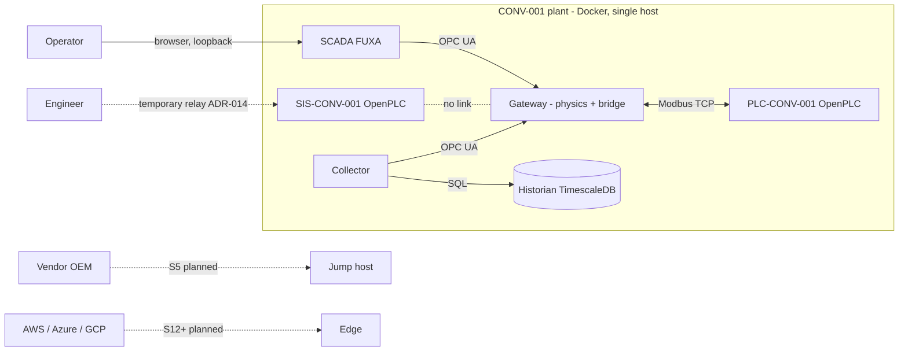
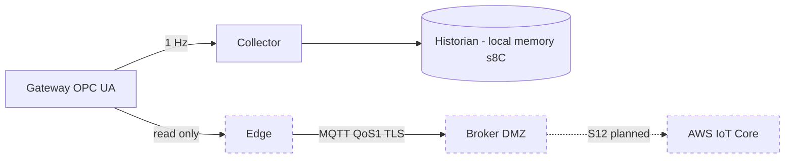
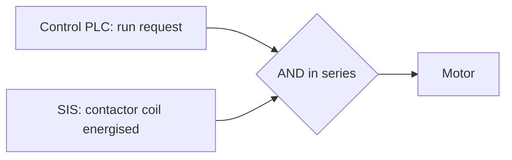
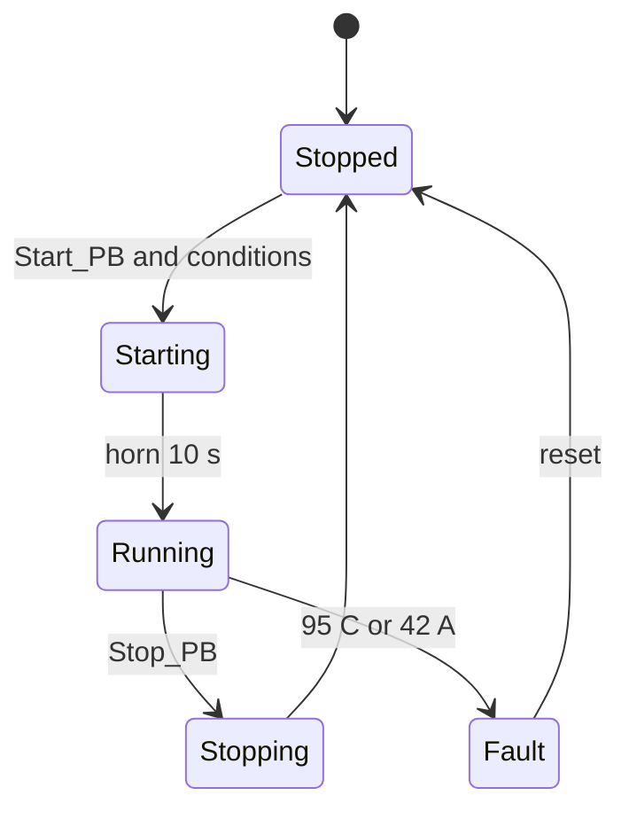
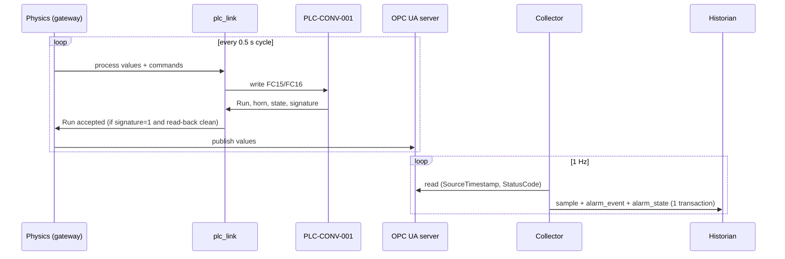
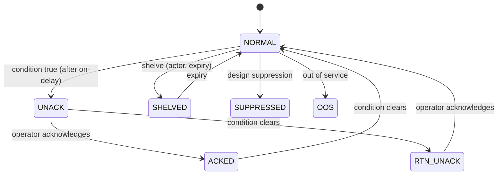
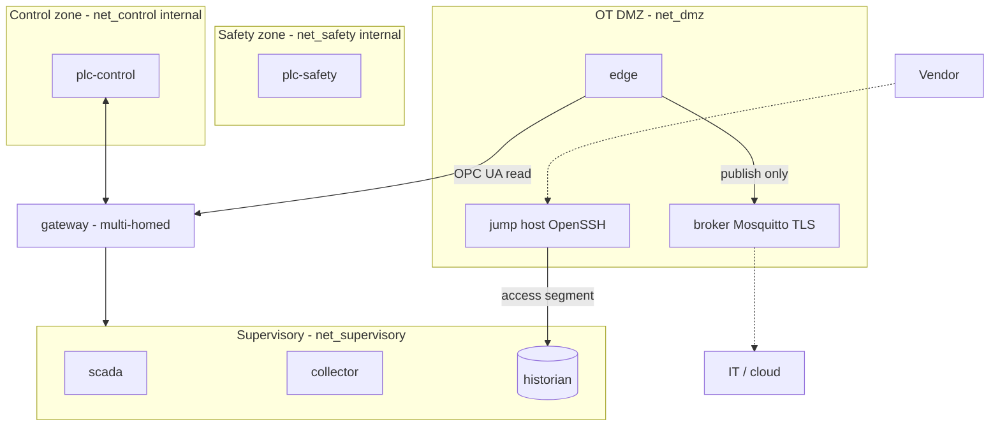

# Vigilimen — Technical Specification (reference)

**Status:** draft v0.1 · **Date:** 26 October 2026 (AEST) · **Draft by:** Claude, for E. Zaré · **Scope:** the whole project, from the CONV-001 simulated plant (proven) to Sprint 29 (planned).

> **How to read this document without confusion.** Every technical statement carries one of three marks:
>
> | Mark | Meaning | Test |
> |---|---|---|
> | **[PROVEN]** | A check that was actually run (fitness function, Docker run, measurement) established it | The script or note is cited |
> | **[WRITTEN]** | The code, ADR or config says so, but nothing exercises it against reality | Readable in the repository, never executed against the real thing |
> | **[PLANNED]** | Design or decision for a future sprint. It does not exist | Draft ADR, delivery plan |
>
> When in doubt between PROVEN and WRITTEN, it is WRITTEN. The `scripts/ff*.py` files and `docs/adr/` files are the numbering authority (`docs/adr/NUMBERING.md`). This document describes; it decides nothing.

---

## 1. The project on one page

Vigilimen is an IT/OT security portfolio. A **simulated mining conveyor (CONV-001)** is the System under Consideration (ADR-003) used to demonstrate, sprint by sprint, the security of a mine site: IEC 62443 segmentation, an OT DMZ, vendor remote access, passive asset inventory, a 62443-3-2 risk assessment, ATT&CK for ICS scenarios, FAT/SAT, the CIRMP dossier, then IT/OT convergence on three clouds (AWS senses, Azure acts, GCP learns — ADR-001).

Two ideas structure everything:

1. **The automation protocol authenticates nobody** (Modbus has no mechanism at all). Segmentation *is* the authentication (`protocol-register.md`). **[WRITTEN]**
2. **The safety function (SIS) is a separate controller and carries no cybersecurity control** (ADR-011). A control that can fail a safety function makes the plant less safe. **[WRITTEN]**; logical independence is **[PROVEN]** by FF-06/FF-21; physical independence is not (see §9, D-02).

**Where we are (26 Oct 2026):** S0–S4 closed. The plant runs as 6 Docker containers, the control PLC is linked to the gateway over Modbus, and the alarm history survives restarts and tampering (FF-28). Next: S5 (edge, DMZ, remote access), start 16 Nov 2026.

---

## 2. Overview

### 2.1 Context (who talks to what)

### 2.2 The containers — existence and wiring **[PROVEN]** (FF-22); ports **[WRITTEN]** from `docker-compose.yml`

| Service | Role | Network(s) | Host port (127.0.0.1) | Note |
|---|---|---|---|---|
| `plc-control` | PLC-CONV-001, OpenPLC v3: sequence + machine protection | `net_control` | 8081 (UI), 15020→502 (Modbus) | End-of-life (ADR-015) |
| `plc-safety` | SIS-CONV-001, OpenPLC v3: safety function | `net_safety` | 8082 (UI) | **Sole** member of its network (ADR-014) |
| `gateway` | Conveyor physics + OPC UA server + Modbus client to the PLC + modelled contactor | `net_control`, `net_supervisory` | 14840→4840 (OPC UA) | Only service spanning two zones |
| `scada` | FUXA (MIT, ADR-012), OPC UA client | `net_supervisory` | 1881 | |
| `historian` | TimescaleDB: samples + alarm history | `net_supervisory` | 15432→5432 | |
| `collector` | Reads OPC UA at 1 Hz, writes the historian, evaluates alarms | `net_supervisory` | none | |

Networks: `net_control` internal, `net_safety` internal, `net_supervisory` ordinary bridge. No published port off loopback (ADR-018, FF-22). **[PROVEN]**

### 2.3 Two operating modes — a frequent source of confusion

| | **PLC mode** | **Embedded mode** |
|---|---|---|
| Variable | `VIGILIMEN_PLC_LINK=modbus` (compose default) | `VIGILIMEN_PLC_LINK=off` (code default in `opcua_server.py`) |
| Who decides "Run" | The `conveyor.st` program inside OpenPLC | A Python model in the gateway |
| Use for | Normal operation, FF-27 | Tests without a PLC, FF-26 without Modbus |
| Trap | The PLC must have its program loaded or the signature ≠ 1 | Results not comparable with PLC mode |

The two defaults differ (compose = `modbus`, code = `off`). **[WRITTEN]** After every `docker compose up`, check the mode ("linked to plc-control:502, read-back clean" in the gateway log).

---

## 3. Collector, historian, edge: who does what, and why three

This is the question that produced the most confusion. Short answer: **three different jobs, three different failure modes, three different recipients.**

| | **Collector** | **Historian** | **Edge** (planned S5) |
|---|---|---|---|
| Nature | Python process (`plant/historian/collector.py`) | TimescaleDB (`plant/historian/schema.sql`) | Python process to be written (ADR-020) **[PLANNED]** |
| Verb | **Reads** the process and **evaluates** alarms | **Keeps** the local memory | **Pushes** off the site |
| Input | Gateway OPC UA, 1 Hz, source-timestamped | SQL from the collector | Gateway OPC UA (client, never writes) |
| Output | SQL rows (`sample`, `alarm_event`, `alarm_state`) | Data, 5-min/1-h views, immutable alarm history | MQTT messages (QoS 1) to the broker in the DMZ |
| If the WAN drops | No effect | No effect | Durable local queue (SQLite), replay on return |
| If it dies | No history or alarms; the plant keeps running | Collector fails; the plant keeps running | The cloud receives nothing; **the site keeps everything** |
| Needs the Internet | **No** | **No** | Yes, by construction |

**Why the edge is not merged into the collector/historian (s8C).** The enhanced CIRMP rule s8C requires the critical system to **operate independently for three months** while external systems are restored. **[WRITTEN]** If the edge *were* the collector, a WAN, broker or cloud failure would reach the local history and the alarms — exactly what s8C forbids. So the local chain (gateway → collector → historian) stays **untouched and with no outbound dependency**, and a separate outbound path is added beside it, one we accept may fail. This separation is **decided in writing** (ADR-020, draft) **[PLANNED]**; the three-month proof is planned for S26 **[PLANNED]**. On the target site the collector has no route out; FF-04 (planned) will check it **[PLANNED]**.

**Why a collector *and* a historian?** The collector is effectively stateless: it can restart in milliseconds because alarm state is stored *with* the history in the same transaction (ADR-019, FF-25). **[PROVEN]** The historian is the only thing that keeps data; restarting the collector must not rewrite history. **[PROVEN]**

**If you know AVEVA PI.** On PI, the interface and the Data Archive are usually thought of as one system, and in day-to-day use they are. The mapping here is: **collector ≈ PI Interface/Connector** (reads the source, stamps it, applies quality), **historian ≈ PI Data Archive** (stores and serves), and **edge ≈ PI Buffer Subsystem + Connector Relay / PI-to-cloud** (buffers and forwards off site). The difference is that PI's buffering sits *in front of* the archive on the same path, while here the outbound path is a **separate branch**: the local collector→historian chain is never made to depend on it. Here the collector additionally evaluates alarms (PI would do that in Notifications/Asset Framework analytics), which is why its restart behaviour matters (ADR-019). Treating collector+historian as one logical "local historian" is fine; the split is for code and failure isolation, not for a different purpose.

**Trap to avoid:** the edge is not "a second collector". It computes no alarm, stores only what it has not yet been able to send, and only publishes (no subscription: no downward command path, ADR-005). **[PLANNED]**

(Dashed = planned, does not exist.)

---

## 4. The safety function and the contactor

### 4.1 Principle (ADR-011) **[WRITTEN]**, logic **[PROVEN]** (FF-06, FF-21)

`motor turns = safety contactor energised AND control run request`. The control PLC can stop the belt; it cannot start it against a trip; the SIS stops it with the PLC absent, powered down, or commanding RUN.

### 4.2 How it is realised in the plant

- `plc-safety` has **no link of any kind** (single-member internal network). **[PROVEN]** FF-22 + `tools/prove-isolation.ps1`.
- Its contactor is a Python `SafetyFunction` (`plant/sim/interlock_model.py`) inside the gateway: the "series wiring" becomes one line of code (ADR-014). **[WRITTEN]**
- Engineering access to the SIS is a deliberate temporary human act: a throwaway container joins `net_safety` (`tools/plc-ui-relay.ps1 -Target safety -ConfirmSafety`) then is removed; the isolation check fails if one is left. **[WRITTEN]**
- `interlock_model.py` is a **model** of `safety.st`/`conveyor.st`, not the program. FF-21 reads `safety.st` on disk. **[PROVEN]** Not proven: that the program *running* in OpenPLC behaves as the model says for safety (only the control PLC has end-to-end proof: FF-27).

### 4.3 Control PLC state machine (`conveyor.st`) — trips **[PROVEN]** by FF-27

| `Plc_State` | Name | Note |
|---|---|---|
| 0 | stopped | |
| 1 | warning | bearing ≥ 85 °C (alarm) |
| 2 | starting | 10 s horn |
| 3 | running | |
| 4 | stopping | |
| 5 | fault | bearing ≥ 95 °C or current ≥ 42 A (machine trips) |

(Summary only; exact transitions are in `plant/plc-control/conveyor.st`.) **[WRITTEN]**

---

## 5. Interfaces

### 5.1 Modbus contract, gateway ↔ PLC (`plc_io_map.py`, ADR-013) — `MAP_VERSION = 1`

The **client is the gateway**; it plays the field (sensors, buttons) and reads the PLC's decisions.

| Name (conveyor.st) | IEC address | Type | Direction | Scale |
|---|---|---|---|---|
| Start_PB | %QX100.0 | BOOL | → PLC | |
| Stop_PB | %QX100.1 | BOOL | → PLC | |
| Zero_Speed | %QX100.2 | BOOL | → PLC | |
| Upstream_Ready | %QX100.3 | BOOL | → PLC | |
| Downstream_Ready | %QX100.4 | BOOL | → PLC | |
| Bearing_Temp_x10 | %QW100 | UINT | → PLC | ×10 (°C) |
| Motor_Current_x10 | %QW101 | UINT | → PLC | ×10 (A) |
| Belt_Speed_x100 | %QW102 | UINT | → PLC | ×100 (m/s) |
| Motor_Run | %QX101.0 | BOOL | PLC → | |
| Alarm_Horn | %QX101.1 | BOOL | PLC → | |
| Alarm_Word | %QW110 | WORD | PLC → | |
| Plc_State | %QW111 | UINT | PLC → | |
| Plc_Map_Version | %QW112 | UINT | PLC → | signature |

`conveyor.st` ↔ map consistency: **[PROVEN]** FF-23.

**Three behaviours that are the point of `plc_link.py`** — **[PROVEN]** by FF-24 against a fake OpenPLC; **[PROVEN]** by FF-27 against the real one:
1. **Loss of the PLC = no run request** (fail-safe); no answer means "not running".
2. **Signature first.** OpenPLC v3 *stores* a Modbus write to an address no program locates and reads it back without error (measured 25 Oct). A read-back proves nothing; only `Plc_Map_Version` proves the right program is running. Not detected at run time: a program with the right signature that lacks one input (FF-23 catches that at commit).
3. **Never block the OPC UA loop**: rate-limited reconnects, exchange in a worker thread.

### 5.2 Gateway OPC UA address space **[WRITTEN]** (`opcua_server.py`)

Read-only: `Running`, `SafetyTripped`, `BeltSpeed_mps`, `Load_tph`, `BearingTemp_C`, `Vibration_mms`, `MotorCurrent_A`, `PlcLinkOK` (i=20), `PlcState` (i=21), `PlcAlarmWord` (i=22).
Writable: `StartCommand`, `StopCommand`, and the five fault-injection tags `FaultBearingWear`, `FaultBeltSlip`, `FaultMisalignment`, `FaultIdlerSeizure`, `FaultVibrationSpike` (i=15..19, ADR-016, clamped 0..1; spike 0..10 mm/s; NaN → 0).

**Evolution rule:** **append at the end, never insert**: asyncua numbers nodes in creation order and FUXA binds `ns=2;i=N`. **[WRITTEN]**

**Accounts (`historian`, `engineer`).** Same role: the difference is **attribution**, not **authorisation** (ADR-017). Accepted consequence: a compromised collector can write `StartCommand`. **[WRITTEN]**, a known limit (see D-06).

### 5.3 Historian schema **[WRITTEN]** for the DDL, **[PROVEN]** for immutability (FF-28) and persistence (FF-25)

| Object | Role |
|---|---|
| `asset`, `tag` | Asset hierarchy and signal definitions (ISA-95) |
| `sample` | Hypertable, 1-day chunks, compression at 7 days, **90-day retention** |
| `sample_5m`, `sample_1h` | Continuous aggregates |
| `alarm_event` | Transition history, **append-only** (triggers refuse UPDATE/DELETE/TRUNCATE), **outside** the hypertable to escape retention; `actor` column |
| `alarm_state` | Current state of each alarm, written in **the same transaction** as the events (ADR-019) |
| `sample_aest` | Display view in Brisbane time (ADR-010) |

Time rule (ADR-010): everything a machine writes is **UTC**; everything a human reads is **Australia/Brisbane (AEST, UTC+10, no daylight saving)**. Conversion at presentation only. **[WRITTEN]**

### 5.4 One sample, end to end

Three collector decisions **[WRITTEN]**: **source** timestamp (not insert time), **quality carried** (192 good / 64 uncertain / 0 bad), and the code **only reads** (a property of the code, not of the account).

---

## 6. The alarm engine (S4, ISA-18.2) — `plant/alarms/engine.py`

States: `NORMAL`, `UNACK`, `ACKED`, `RTN_UNACK`, `SHELVED`, `SUPPRESSED`, `OOS`. **[WRITTEN]** for the definitions; transitions **[PROVEN]** by FF-07 (model), FF-25 (persistence across restart), FF-26 (running stack), FF-28 (restart during SHELVED, expiry, tamper refusal).

Configured alarms (each has deadband and on-delay) **[WRITTEN]**:

| Tag | Condition | Limit | Priority | On-delay |
|---|---|---|---|---|
| BearingTemp_C | HI / HI_HI | 85 / 95 °C | HIGH / URGENT | 10 s / none |
| Vibration_mms | HI / HI_HI | 4.5 / 7.1 | LOW / HIGH | 30 s / none |
| Current_A | HI / HI_HI | 38 / 42 A | LOW / HIGH | 5 s / none |
| Speed_mps | LO / LO_LO | 2.0 / 0.1 | LOW / HIGH | 15 s / none |

(Simplified; `engine.py` is the authority.) **Open decision:** no event is produced when the condition clears *during* SHELVED — ISA-18.2 behaviour not verified.

Why this is a "manipulable surface": S8 will shelve, suppress and take alarms out of service as an attacker would; the history records the `actor` precisely so that "who shelved it, and when" has an answer (S24).

---

## 7. Security zones and the target (S5 DMZ)

### 7.1 Today **[PROVEN]** (FF-22)

| Zone / network | Members | Property |
|---|---|---|
| `net_safety` (internal) | plc-safety | Single member; no route in or out |
| `net_control` (internal) | plc-control, gateway | No route off the host |
| `net_supervisory` (bridge) | gateway, scada, historian, collector | Ports published on 127.0.0.1 only |

### 7.2 Target at S5 — design only **[PLANNED]** (`docs/architecture/dmz-target.md`, ADR-020, ADR-021, drafts)

Key design facts established from the real compose **[WRITTEN]**:
- Docker ignores published ports on `internal` networks, and a DMZ the host must reach cannot be `internal`.
- ADR-017 means a read-only OPC UA account is impossible today; the first brokered-access target is therefore the historian via a read-only PostgreSQL role.
- The delivery plan's "only the broker crosses" is not literally achievable: the multi-homed set is {gateway, edge, jump, historian}.
- Forbidden: any path from IT/DMZ to `net_control`/`net_safety`; any subscription by the edge; any shell access to the SIS.

---

## 8. Fitness functions (FF) catalogue

Rule: **the scripts in the repository are the numbering authority.** 16 numbered; 13 run in CI; FF-26/27/28 need Docker and run outside CI.

| FF | Checks | Where | Status |
|---|---|---|---|
| FF-01 | Governance documents stay under the cut line | `ff01_doc_cut_line.sh` | CI |
| FF-02 | Terraform formatted and valid | `ci.yml` step (no script) | CI |
| FF-03 | No static cloud credential in the tree; workflows request OIDC | `ff03_no_static_credentials.sh` | CI |
| FF-05 | Naming and tagging (tag drives teardown) | `ff05_naming_and_tagging.sh` | CI |
| FF-06 | Safety independence (model) | `ff06_safety_independence.py` | CI |
| FF-07 | Alarm state model is ISA-18.2-shaped | `ff07_alarm_state_model.py` | CI |
| FF-13 | Terraform plan has nothing on the never-create list | `ff13_denylist.py` | CI |
| FF-14 | Federation trust conditions stay narrow | `ff14_federation_scope.sh` | CI |
| FF-21 | `safety.st` on disk matches FF-06's argument | `ff21_safety_st_static.py` | CI |
| FF-22 | Compose still draws the zones (3 networks, 6 services, loopback ports) | `ff22_compose_topology.py` | CI |
| FF-23 | `conveyor.st` ↔ gateway I/O map agree | `ff23_plc_io_map.py` | CI |
| FF-24 | Gateway drives PLC and fails safe (fake OpenPLC) | `ff24_gateway_plc_link.py` | CI |
| FF-25 | Collector restart does not rewrite alarm history | `ff25_alarm_persistence.py` | CI |
| FF-26 | Running stack end to end | `ff26_stack_e2e.py` | Docker only |
| FF-27 | Real OpenPLC machine-protection trips (42 A, 95 °C) | `ff27_plc_trips_e2e.py` | Docker only |
| FF-28 | Alarm history survives tamper and restart during SHELVED | `ff28_alarm_durability.py` | Docker only |

Planned **[PLANNED]**: FF-04 (no OT container has an Internet route), FF-20 (supply chain: digests, SBOM, scan), FF-29 (WAN-outage resilience), proposed FF-30 (remote-access scenario with negative steps) and a broker ACL check. FF-22 must be extended at S5 (it freezes 3 networks and 6 services today).

---

## 9. Technical challenges register

| ID | Challenge | State |
|---|---|---|
| D-01 | OpenPLC v3 stores Modbus writes to unlocated addresses; read-back is blind | Handled by signature register **[PROVEN]** (FF-24/27) |
| D-02 | Safety physical independence cannot be shown in software; contactor is a Python model | Open; witnessed test (SAT) planned S9 |
| D-03 | Model vs real program drift (`interlock_model.py` vs `.st`) | Partly mitigated (FF-21, FF-23); safety ST not run against vectors **[WRITTEN]** |
| D-04 | MatIEC rejects VAR blocks mixing located and plain variables | Worked around in `.st` |
| D-05 | OpenPLC lost its program after a rebuild (cause unchecked) | Open; program reloaded by hand |
| D-06 | ADR-017: all OPC UA accounts can write `StartCommand`/`Fault*` | Accepted; fix needed before the edge (Q2) |
| D-07 | Docker internal networks ignore published ports; DMZ cannot be internal | Design constraint for S5 |
| D-08 | `net_supervisory` internal+relays vs routable (FF-04) | Open question Q1 |
| D-09 | Store-and-forward correctness (dedupe, ordering, bounded queue) | Planned S5, FF-29 |
| D-10 | Hardware MFA cannot be demonstrated in a lab | Policy configured only (ADR-021) |
| D-11 | ISA-18.2 behaviour when condition clears during SHELVED | Open decision |
| D-12 | OpenPLC is EOL (ADR-015) | Accepted, recorded |
| D-13 | Mode mismatch (compose `modbus` vs code `off`) | Check logs after each up |
| D-14 | Script overwritten from an old copy (26 Oct) | Rule: re-read file and check mtime before writing |
| D-15 | Documentation over-engineering | FF-01 cut line |
| D-16 | Cloud cost surprises | ADR-004 (ephemeral windows, FF-13 deny-list) |

---

## 10. ADR catalogue

| ADR | Decision | Status |
|---|---|---|
| 001 | Three clouds split by verb (AWS senses, Azure acts, GCP learns) | Accepted |
| 002 | Modular monolith for the enterprise plane | Accepted |
| 003 | Simulated plant is the System under Consideration | Accepted |
| 004 | Cost control by construction (ephemeral cloud windows) | Accepted |
| 005 | OT boundary unidirectional by default | Accepted |
| 006 | Which regulations apply to a mine (voluntary CIRMP build) | Accepted |
| 007 | Federated identity only; no static cloud credential | Accepted |
| 008 | Entra ID as identity authority for all clouds | Accepted |
| 009 | Nominate AESCSF, map IEC 62443 beneath | Accepted |
| 010 | Machine time UTC; human time Australia/Brisbane | Accepted |
| 011 | Safety function is a separate controller | Accepted |
| 012 | FUXA for SCADA (licence decision) | Accepted |
| 013 | Gateway plays the field, drives PLC over Modbus | Accepted |
| 014 | SIS stays unlinked; contactor modelled in gateway | Accepted |
| 015 | OpenPLC v3 is EOL and used anyway | Accepted |
| 016 | Fault injection tags in gateway address space | Accepted |
| 017 | OPC UA accounts: attribution, not authorisation | Accepted |
| 018 | Demo credentials scope | Accepted |
| 019 | Alarm state persistence | Accepted |
| 020 | Edge stack (separate 7th service, MQTT, store-and-forward) | **Proposed** (draft) |
| 021 | Brokered remote access (jump host, short-lived SSH certs) | **Proposed** (draft) |
| 022 | Diagramming tools (draw.io, Archi, Mermaid) | **Proposed** |

Planned numbers: passive-first discovery (S6), zone partitioning as consequence (S7), FAT hold-point criteria (S9) — next free numbers at write time.

---

## 11. Roadmap S5–S29

| Sprint | Theme | Key outputs |
|---|---|---|
| S5 | Edge, OT DMZ, brokered vendor access | Edge, broker, jump host, store-and-forward, WAN test, SBOM/scan; **gate M1** |
| S6 | OT network visibility and asset inventory | Passive-first discovery, inventory |
| S7 | IEC 62443-3-2 risk assessment (ZCR 1–7) | Zones, conduits, SL-T, CRS |
| S8 | ATT&CK for ICS: attack, detect, measure | Scenarios against the plant, detection coverage |
| S9 | FAT/SAT cybersecurity validation | Hold points, witnessed safety test |
| S10 | Procurement and supply-chain assurance | |
| S11 | CIRMP pack, incident response, tabletop | AESCSF SP-2, OT IRP; **gate M3** |
| S12–S14 | AWS industrial data plane (IoT Core, SiteWise, lake) | **Gate M4** |
| S15–S18 | Azure enterprise plane (monolith, APIM, Angular, integration) | **Gate M5** |
| S19–S21 | ML: SageMaker, GCP warehouse, Vertex | **Gate M6** |
| S22–S23 | GenAI assistant + Power Platform; BI | **Gate M7** |
| S24 | OT SOC across IT and OT | |
| S25 | Observability and SLOs | |
| S26 | DR, chaos game-days, three-month independence proof (s8C) | |
| S27 | FinOps, governance, compliance | |
| S28 | Two demonstrations | |
| S29 | Portfolio packaging and close | |

Cadence: 3-week roster cycles (one 56 h heavy week + two 7 h weeks), M3 early Feb 2027, runway to early 2028 (delivery plan v2.1). Gate M2 and the exact milestone dates are in `pilotage/delivery-plan.md`.

---

## 12. Glossary

| Term | Meaning here |
|---|---|
| **SUC** | System under Consideration — the simulated conveyor |
| **PLC / SIS** | Programmable logic controller (control) / safety instrumented system (protection) |
| **Gateway** | Container that simulates the field and bridges Modbus ↔ OPC UA |
| **Collector** | Reads OPC UA at 1 Hz, writes the historian, evaluates alarms |
| **Historian** | TimescaleDB: local memory of samples and alarm history |
| **Edge** | (Planned) outbound publisher: OPC UA client → MQTT; never writes |
| **DMZ** | Zone between OT and IT where nothing is trusted both ways |
| **Zone / conduit** | IEC 62443 groupings of assets / the controlled paths between them |
| **SL-T / SL-C / SL-A** | Target / capability / achieved security level |
| **s8C** | CIRMP enhanced rule: critical system operates independently for three months |
| **CIRMP** | Critical Infrastructure Risk Management Program (Australia, SOCI) |
| **AESCSF** | Australian Energy Sector Cyber Security Framework |
| **FF** | Fitness function — an automated check that an architectural property still holds |
| **ADR** | Architecture Decision Record |
| **FAT / SAT** | Factory / Site acceptance test |
| **ISA-18.2** | Alarm management standard |
| **TRITON** | Malware that targeted a safety system; origin of ADR-011's rule |
| **Store-and-forward** | Local durable queue that holds messages while the WAN is down |
| **Jump host** | Hardened host in the DMZ through which vendors reach one asset |

---

## 13. What is not yet proven (honest list)

- Physical independence of the safety function (D-02); the SIS program running in OpenPLC against test vectors.
- ISA-18.2 behaviour when a condition clears during SHELVED (D-11).
- Why OpenPLC lost its program after a rebuild (D-05).
- Everything in S5 and later: edge, broker, jump host, WAN resilience, remote-access scenarios, hardware MFA.
- The three-month independence claim (S26).

## 14. Open decisions for E. Zaré

Q1 net_supervisory internal + relays vs routable; Q2 edge account / ADR-017 fix; Q3 deadbands and WAN test load; ADR-021 first target and hardware key; SHELVED-clear behaviour; commit of ADR-020/021, `dmz-target.md`, `diagram-plan.md` and this spec.
