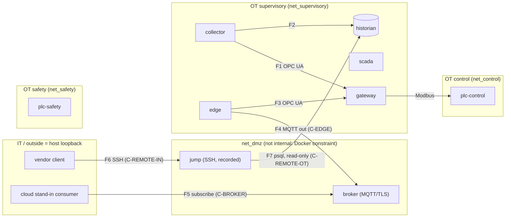

# S5 target topology — OT / DMZ / IT (design draft, 26 Oct 2026)

**Status:** draft for E. Zaré. Nothing here is built or tested. It feeds ADR-020 (edge stack), ADR-021 (brokered remote access), the extension of FF-22 and the first P1 diagram (`docs/architecture/diagram-plan.md`, D1).
**Source of the current state:** `plant/docker-compose.yml` as of commit 044767c (3 networks, 6 services).

## 1. Zones and networks

| Zone | Network | `internal` | Members (target) | Change |
|---|---|---|---|---|
| OT, safety | `net_safety` | yes | `plc-safety` | none |
| OT, control | `net_control` | yes | `plc-control`, `gateway` | none |
| OT, supervisory | `net_supervisory` | **yes (new)** | `gateway`, `scada`, `historian`, `collector`, `edge` | made internal (see 3.1) |
| DMZ | `net_dmz` | no (Docker constraint, see 3.2) | `edge` (second leg), `broker`, `jump` | new |
| Access segment | `net_remote_historian` | yes | `jump`, `historian` (second leg) | new, one per brokered asset |
| IT / outside | the host's `127.0.0.1` | n/a | cloud stand-in consumer, vendor client (host processes) | none |

**New services:** `edge`, `broker` (Mosquitto), `jump` (OpenSSH). Six services become nine.
**Multi-homed services (each one is a registered conduit component):** `gateway` (control + supervisory, existing), `edge` (supervisory + DMZ), `jump` (DMZ + one access segment), `historian` (supervisory + one access segment). Anything else on two networks is a defect.

## 2. Flows

| # | From → to | Protocol, port | Initiator | Conduit | Notes |
|---|---|---|---|---|---|
| F1 | `collector` → `gateway` | OPC UA 4840 | collector | existing | account `historian`; unchanged |
| F2 | `collector` → `historian` | PostgreSQL 5432 | collector | existing | the local historian never depends on the edge or the broker (s8C) |
| F3 | `edge` → `gateway` | OPC UA 4840 | edge | existing | new account `edge` (attribution only, ADR-017) |
| F4 | `edge` → `broker` | MQTT over TLS 8883 | **edge (OT-initiated, outbound)** | C-EDGE | publish only; the edge has no subscription |
| F5 | host consumer → `broker` | MQTT over TLS, published `127.0.0.1:18883` | IT | C-BROKER | subscribe only; cannot publish to the edge's topics |
| F6 | host vendor client → `jump` | SSH, published `127.0.0.1:12222` | vendor | C-REMOTE-IN | named certificate, time-boxed, approved by the operator |
| F7 | `jump` → `historian` | PostgreSQL 5432 on `net_remote_historian` | vendor session | C-REMOTE-OT | read-only role; one asset, one protocol |

**Forbidden, and tested:** any container on an OT network reaching the host or the Internet; IT or the host reaching any OT address; `broker` or any DMZ service opening a connection to `edge`; `jump` reaching `gateway`, `plc-control`, `plc-safety`, `scada` or `collector`; anything but `edge` writing to the edge's topics; anything but `plc-safety` on `net_safety`.

Ports 18883 and 12222 are proposals (not used in the current compose).

## 3. Two Docker facts that change the design

**3.1 Making `net_supervisory` internal breaks three host ports.** Docker ignores `ports:` for a container whose networks are all internal (the walkthrough records this for the OpenPLC UI). Today `scada` (1881), `historian` (15432) and `gateway` (14840) are published through `net_supervisory`. If that network becomes internal, FUXA's UI and the host-side OPC UA and psql access stop working, unless a relay is used, as `tools\plc-ui-relay.ps1` already does for the PLC UIs.
*Decision needed (ADR-020, open question Q1):* (a) make `net_supervisory` internal and add relays, so that FF-04 ("no OT container has an Internet route") is true of the supervisory zone too; or (b) keep it routable and define FF-04 over `net_control` and `net_safety` only, saying plainly that SCADA, historian and collector keep a route today. Option (a) is the stricter reading of the S5 gate and costs a relay for FUXA.

**3.2 `net_dmz` cannot be internal if the host must reach the broker and the jump host.** Same rule: a published port needs at least one non-internal network. So the DMZ here has a default route that a real DMZ would deny. This is a limitation of the simulation and goes into ADR-020 and ADR-021 as such. Not verified: that a container on one internal and one non-internal network publishes correctly. To test first, in Docker.

## 4. What FF-22 should check after S5 (proposal, numbers and cases decided when the script is edited)

1. The service set is exactly the nine expected.
2. `net_control`, `net_safety`, every `net_remote_*` and (if Q1 = a) `net_supervisory` are internal.
3. `net_safety` still has exactly one member, `plc-safety`, which is on nothing else.
4. `net_dmz` members are exactly `edge`, `broker`, `jump`.
5. The multi-homed set is exactly {`gateway`, `edge`, `jump`, `historian`}.
6. `edge` is on exactly {`net_supervisory`, `net_dmz`}; `broker` on exactly {`net_dmz`}.
7. No service is on both `net_dmz` and `net_control` or `net_safety`.
8. Each `net_remote_*` has exactly two members: `jump` and one asset.
9. Published ports: only `broker` and `jump` among the new services, all on `127.0.0.1`.

Mutations to add (each must make FF-22 fail): `edge` joins `net_control`; `broker` joins `net_supervisory`; `gateway` joins `net_dmz`; the broker port published on all addresses; a second asset joins `net_remote_historian`; `jump` joins `net_supervisory`.
Other tests are separate FFs: FF-04 (no Internet route, static and live), FF-20 (digests, SBOM, scan), FF-29 (WAN cut), and the proposed broker ACL and remote-access scenarios (see the ADRs).

## 5. Reference sketch (to check your drawing, not the deliverable)

## 6. Drawing brief for D1 (draw.io)

- Landscape, left to right: **IT / outside | DMZ | OT supervisory | OT control | OT safety**. Safety at the bottom, visibly isolated, one box, no arrow in or out.
- One band per zone, label each with its network name and `internal` yes or no. Mark the DMZ band "not internal (simulation constraint)".
- Draw the four multi-homed services (`gateway`, `edge`, `jump`, `historian`) with a double border so the reader sees where zones touch.
- One arrow per flow F1 to F7, labelled with its number, protocol, port and **the initiator** (arrowhead at the target). Conduit IDs on F4 to F7. SL-T shown as "provisional until S7".
- A second layer or a red dashed set for the forbidden flows of section 2.
- Title block per ADR-022 rule 4: title, sprint, date, version, legend. Save uncompressed; commit the `.drawio` with its SVG export as `docs/architecture/diagrams/S5-dmz-target.drawio`.
